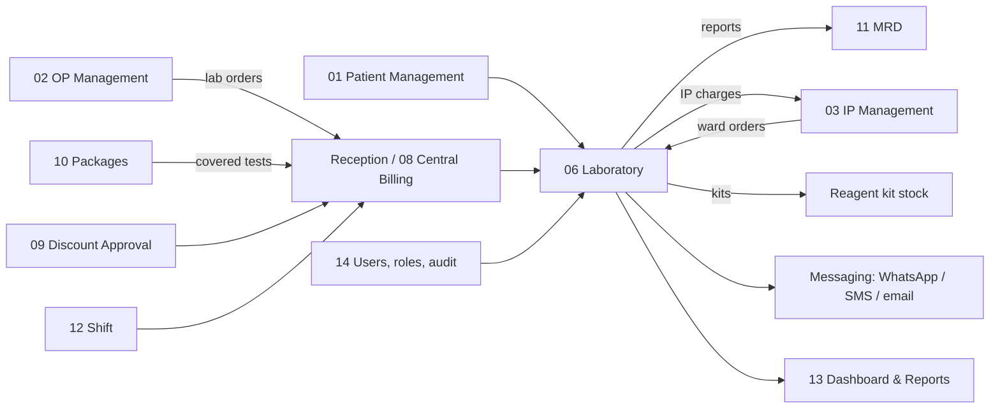
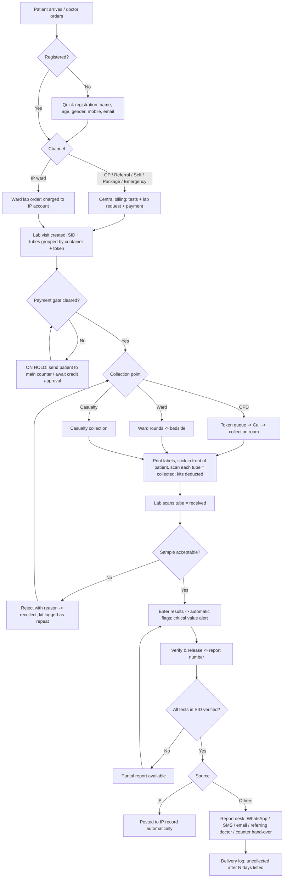
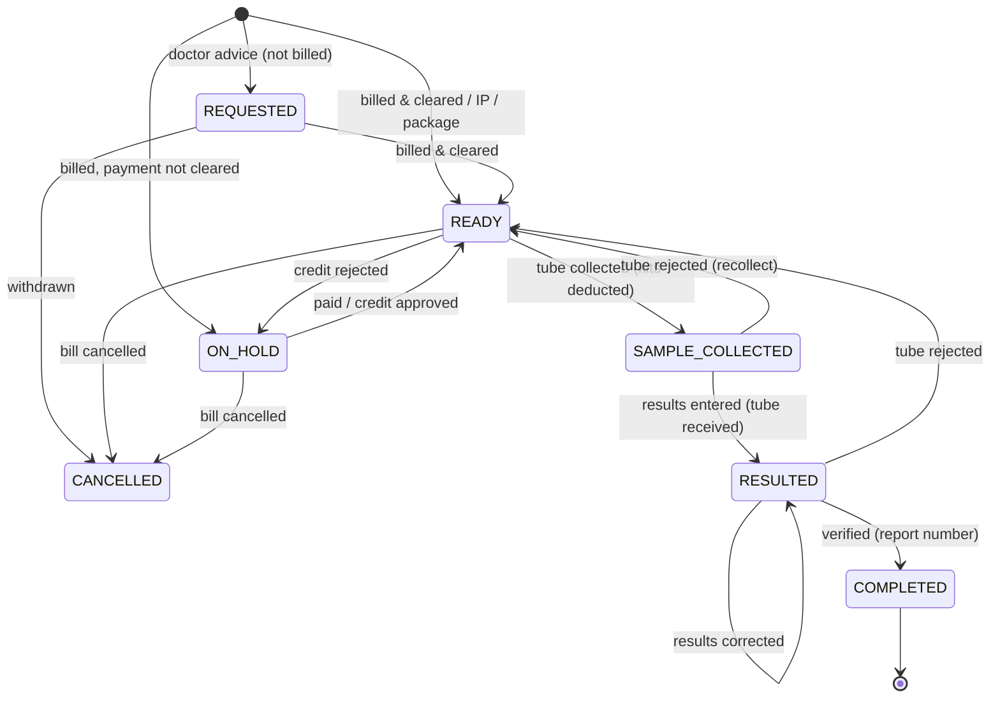
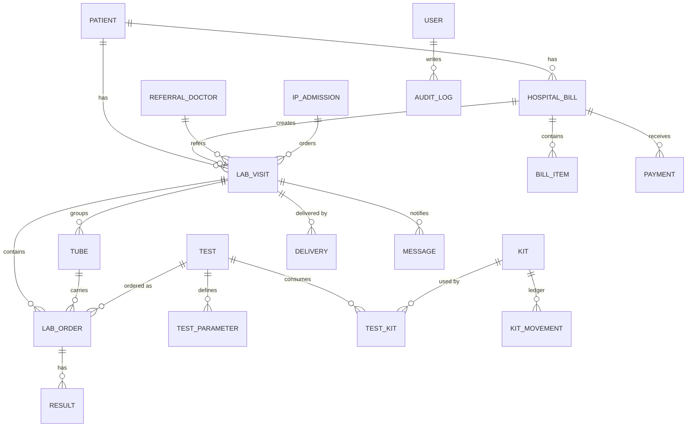

# Nallam Hospital HMS — Laboratory Module Specification

**Module:** BRD Module 06 — Laboratory Management (with its dependencies on Module 01 Patient Management, Reception / Module 08 Central Billing, 02 OP, 03 IP, 07 Services, 09 Discount Approval, 10 Packages, 11 MRD, 12 Shift, 13 Dashboard and 14 User Management)
**Document type:** Functional + technical specification (build reference)
**Version:** 1.0 · **Status:** Baseline from the approved demo (branch `feature_d`) · **Audience:** product owner, backend & frontend developers, QA, the hospital's lab in-charge

> The demo (HTML/JS + JSON) is the **reference implementation** of every rule in this document. The production system must reproduce the same flow, the same states and the same rules on a real backend (Spring Boot + MySQL, as planned in the README). Where production must do *more* than the demo, it is marked **[PROD]**.

---

## Table of contents

1. [Purpose and scope](#1-purpose-and-scope)
2. [Glossary](#2-glossary)
3. [Status: demo vs production](#3-status-demo-vs-production)
4. [Module dependencies and contracts](#4-module-dependencies-and-contracts)
5. [Actors, roles and permissions](#5-actors-roles-and-permissions)
6. [Entry channels — how a patient reaches the lab](#6-entry-channels--how-a-patient-reaches-the-lab)
7. [End-to-end flow](#7-end-to-end-flow)
8. [Reception: patient identification and registration](#8-reception-patient-identification-and-registration)
9. [Billing and the payment gate](#9-billing-and-the-payment-gate)
10. [Identifiers: SID, token, tube codes, report numbers, barcodes](#10-identifiers-sid-token-tube-codes-report-numbers-barcodes)
11. [Sample collection](#11-sample-collection)
12. [Sample receipt, rejection and recollection](#12-sample-receipt-rejection-and-recollection)
13. [Result entry, flags, critical values and verification](#13-result-entry-flags-critical-values-and-verification)
14. [The lab report](#14-the-lab-report)
15. [Report delivery and messaging (WhatsApp / SMS / email)](#15-report-delivery-and-messaging-whatsapp--sms--email)
16. [Reagent kits and reconciliation](#16-reagent-kits-and-reconciliation)
17. [Turnaround time (TAT) and service levels](#17-turnaround-time-tat-and-service-levels)
18. [State machines](#18-state-machines)
19. [Business rules — consolidated list](#19-business-rules--consolidated-list)
20. [Notifications and alerts](#20-notifications-and-alerts)
21. [Audit trail](#21-audit-trail)
22. [Reports and dashboards](#22-reports-and-dashboards)
23. [Data model](#23-data-model)
24. [Database schema (MySQL proposal)](#24-database-schema-mysql-proposal)
25. [REST API specification](#25-rest-api-specification)
26. [Backend architecture](#26-backend-architecture)
27. [Screens and UI specification](#27-screens-and-ui-specification)
28. [Configuration (Hospital Setup)](#28-configuration-hospital-setup)
29. [Master data — test catalogue, containers, kits](#29-master-data--test-catalogue-containers-kits)
30. [Security, privacy and compliance](#30-security-privacy-and-compliance)
31. [Non-functional requirements](#31-non-functional-requirements)
32. [Edge cases and exception handling](#32-edge-cases-and-exception-handling)
33. [Acceptance test cases](#33-acceptance-test-cases)
34. [Future enhancements (phase 2+)](#34-future-enhancements-phase-2)
35. [Open questions for the hospital](#35-open-questions-for-the-hospital)
36. [Demo code map](#36-demo-code-map)
37. [Lab Test Master (managing the test list)](#37-lab-test-master-managing-the-test-list)

---

## 1. Purpose and scope

### 1.1 Purpose
The laboratory module manages every diagnostic test from the moment it is requested until the report reaches the patient or doctor, so that:

- **no test is done without a bill or an approved credit / emergency / IP / package route** (BRD rule *Billing & Payment Control*);
- **no cash is handled inside the lab** (BRD Module 06);
- every sample is **identified by barcode** from collection to report;
- results are **flagged automatically**, **verified** by an authorised person, and **reported in one combined report per visit**;
- reports are **delivered** on WhatsApp / SMS / email or handed over at the counter, with a log;
- **reagent kits used are compared with tests billed** to detect tests done without a bill (BRD Module 06, client meeting: "kits used vs billed").

### 1.2 In scope
| Area | Included |
|---|---|
| Entry channels | OP doctor order, IP ward order, emergency, outside prescription (referral), self request, health package |
| Reception | Quick registration, prescription capture, referral doctor, priority, consent |
| Billing | Lab lines on the central bill, payment gate, credit / emergency, discount approval, cancellation & refund |
| Collection | OPD token queue, waiting-room token display, ward rounds, casualty, tube grouping, labels, scan-to-collect |
| Lab processing | Tube receipt by scan, rejection & recollection, result entry, flags, critical values, verification |
| Reports | Combined report per SID, partial report, reprints, report numbering |
| Delivery | WhatsApp, SMS, email, referring doctor copy, counter hand-over, IP record posting, uncollected list |
| Inventory | Reagent kits, QC / repeat / wastage logging, physical counts, reconciliation |
| Control | Audit log, notifications, dashboards, TAT, referral statistics |

### 1.3 Out of scope (phase 1)
- Direct analyser interfacing (HL7 / ASTM) — designed for in §34, not built.
- Microbiology culture workflows, histopathology, blood bank — separate future modules.
- Outsourced (send-out) tests to an external reference lab — §34.
- Home sample collection booking — §34.
- Insurance / TPA pre-authorisation — belongs to Central Billing phase 2.

---

## 2. Glossary

| Term | Meaning |
|---|---|
| **Patient ID / UHID** | Unique hospital ID of a person, e.g. `NH-UH-026175`. One per person for life. |
| **SID (Sample ID)** | One number per **lab visit** (one bill or one ward order), e.g. `04010063`. Printed on the bill and every label. |
| **Lab visit** | A group of lab tests ordered together for one patient at one time (one SID). |
| **Lab order** | One test inside a visit (e.g. CBC). Has its own results and report number. |
| **Tube / container** | A physical sample container. Tests that share a container type share one tube. |
| **Tube code** | `SID-n`, e.g. `04010063-2`. Printed as a barcode on the tube label. |
| **Accession** | Receiving a tube into the lab (scan). In the data the order's `accession` = its tube code. |
| **Entry channel / source** | How the request reached the lab: `OP`, `IP`, `EMERGENCY`, `REFERRAL`, `SELF`, `PACKAGE`. |
| **Billing route** | How the visit is paid: `COUNTER`, `IP_ACCOUNT`, `EMERGENCY`, `PACKAGE`. |
| **Payment gate** | The rule that blocks collection until the billing route is cleared. |
| **Priority** | `ROUTINE`, `URGENT`, `STAT` (immediate). |
| **TAT** | Turnaround time — from billing/order to verified report. |
| **Flag** | `H` high, `L` low, `HH` critical high, `LL` critical low, `A` abnormal (text result). |
| **Critical value** | A result so far out of range that the doctor must be told immediately. |
| **Verification** | Sign-off by the authorised person; the report becomes final and gets a report number. |
| **Referral doctor** | An **outside** doctor who sent the patient with a prescription. |
| **Kit / reagent** | Consumable used per test (cartridge, strip, reagent pack). |
| **QC** | Quality control runs that consume reagent but are not patient tests. |
| **Ward rounds** | The phlebotomist's list of IP patients to collect at the bedside. |

---

## 3. Status: demo vs production

The demo implements **100 % of the functional flow** in this document. Production must add the items in the right column.

| Capability | Demo (`feature_d`) | Production adds **[PROD]** |
|---|---|---|
| All 6 entry channels | ✅ | OP & IP orders come from modules 02 / 03 instead of the demo's request screen / MRD admissions |
| Quick registration, duplicate check | ✅ | Server-side duplicate check, Aadhaar/ABHA optional field |
| Prescription upload | ✅ stored in browser IndexedDB | Object storage (S3 / MinIO / server disk), virus scan, image compression |
| Central bill + payment gate | ✅ | Payment gateway / UPI QR reconciliation (optional) |
| SID, token, tube grouping, labels | ✅ Code 128 SVG | Direct printing to a 50 × 25 mm thermal label printer (ZPL / TSPL) |
| Token display | ✅ in-browser page | Separate TV device, audio announcement (text-to-speech), live push |
| Scan to collect / receive | ✅ keyboard-wedge scanner | Same (USB / Bluetooth scanner) |
| Results, flags, critical values, verification | ✅ | Delta check rules per test, age/sex-specific ranges, analyser interface |
| Combined report per SID | ✅ HTML → browser PDF | Server-side PDF (digitally signed), QR verification code |
| WhatsApp | ✅ click-to-send (`wa.me`) + outbox log | **WhatsApp Business Platform (Cloud API)** automatic sending with PDF via a server worker |
| SMS / email | ✅ opens device app | SMS gateway (DLT-registered templates, India) and SMTP/transactional email |
| Kits & reconciliation | ✅ | Lot / expiry per kit, link to Store purchases |
| Audit, notifications, dashboards | ✅ | Real-time push (WebSocket / SSE), retention policies |
| Data | JSON + localStorage | MySQL, backups, multi-user concurrency, row locking |

---

## 4. Module dependencies and contracts



### 4.1 Patient Management (Module 01) — **hard dependency**
| The lab needs | Provided by Patient Management |
|---|---|
| A registered patient for every visit | `patients` record with `id`, `uhid`, `name`, `gender`, `age` or `dob`, `phone`, optional `email`, `allergies` |
| Quick registration from the billing screen | `registerPatient()` — minimum fields: **name, gender, age (or DOB), 10-digit mobile**. Address, email, guardian, blood group are optional |
| Duplicate protection | `findDuplicates({ name, phone, dob, age })` — same mobile, or same name with age ± 1 year → warning "This patient may already be registered" |
| Patient timeline | Every completed lab order appears on the patient profile ("Lab report — CBC", report number, SID) |
| Allergy alert | Shown on the collection dialog and result screen |

Rules:
- **PM-1** A lab visit can never be created for an unregistered person. Walk-in lab patients are registered with the quick form (the standalone-lab practice: name, age, phone, email).
- **PM-2** Email is optional but required to send the report by email.
- **PM-3** Mobile must match `^[6-9]\d{9}$` (Indian mobile) — it is the WhatsApp number.

### 4.2 Reception / Central Billing (Module 08) — **hard dependency**
| The lab needs | Contract |
|---|---|
| Lab tests billed against a patient | Bill item `category = LAB`, one `orders` row per unit |
| The **lab request** context | `draft.lab = { source, referralDoctorId, priority, prescription, consent, notes }` |
| Visit creation | When the bill is saved, `createVisitForBill(bill, labOrders, lab, user)` creates **one SID** for all lab orders of that bill, groups tubes, assigns a token |
| Payment status | `billClears(bill)` = balance ≤ 0 **or** credit approved / emergency |
| Collection of balance later | `collectHospitalPayment()` → orders on hold become `READY` automatically |
| Cancellation | Owner-approved; allowed only while no test is resulted/completed; all orders → `CANCELLED`, refund recorded |

### 4.3 OP Management (Module 02) — **integration contract**
- The OP doctor orders tests during consultation. OP calls `requestServices({ patientId, serviceIds, doctor, note }, user)` → orders with status **`REQUESTED`** (not billed).
- Reception sees them on the billing screen under **"Advised by the doctor — not billed yet"**, adds them with one click; the bill links the existing order rows (no duplicates) and the visit gets `source = OP`.
- OP needs from the lab: the report for the consultation screen (`orders` where `patientId` and `status = COMPLETED`), and the critical-value alert.

### 4.4 IP Management (Module 03) — **integration contract**
- Ward orders do **not** pass the counter. IP calls `createIpOrder({ recordId, serviceIds, doctor, priority, notes }, user)`.
  - Demo: `recordId` = an open MRD admission record (`medicalRecords` with `episodeType = IP`, no discharge).
  - **[PROD]** replace with the IP admission id; ward and bed come from the bed allocation.
- Each IP order carries `ipCharge = { amount, ipNo, posted: false }`. **The IP final bill must read all unposted lab charges for the IP number, add them to the bill, and set `posted = true`.**
- Collection point is `WARD`; the visit appears in **Ward rounds** with ward and bed.
- When the whole SID is verified, the report is **posted to the IP record automatically** (delivery channel `WARD`).

### 4.5 Packages (Module 10)
- A package sold on a bill creates a patient enrolment. Package-covered lab tests are billed at ₹0 (`coveredBy = enrolmentId`), and the visit's `billingRoute = PACKAGE` when **all** lab orders are covered.
- Extras outside the package are billed normally.

### 4.6 Discount Approval (Module 09)
- Staff can give up to **10 %** on a bill. Above that, `requestHospitalDiscount(draft, reason)` → Super Admin approves / rejects → the counter completes the bill with the approved %.

### 4.7 Shift Management (Module 12)
- Every payment on a lab bill belongs to the cashier's open shift. Billing is blocked until the cashier starts a shift (except Super Admin).

### 4.8 MRD (Module 11)
- Lab reports within an admission window are listed on the MRD record ("Lab reports in this stay") and form part of the discharge summary's *Investigation results*.

### 4.9 Messaging
- Shared service `messaging.js` (outbox, templates, providers). The lab is its first user; pharmacy, OP appointment reminders and billing receipts can reuse it later.

### 4.10 Users, roles, audit (Module 14)
- Permissions in §5; every state change writes an audit event (§21); workstation restriction applies (lab users sign in only at the Laboratory workstation when enforcement is on).

---

## 5. Actors, roles and permissions

### 5.1 Actors
| Actor | Role code | Does |
|---|---|---|
| Front-office / billing executive | `RECEPTION` | Registers patients, raises lab bills, uploads prescriptions, collects balances, hands over reports, sends reports |
| Lab technician / phlebotomist | `LAB` | Calls tokens, collects samples, receives tubes, enters results, verifies (if allowed), sends reports, manages kits, places ward orders |
| Pathologist / lab in-charge | `LAB` (+ verification) or `SUPER_ADMIN` | Verifies and releases reports |
| Ward nurse / service counter | `SERVICE_COUNTER` | Records doctor requests, places ward lab orders |
| MRD officer | `MRD` | Reads reports for medical records |
| Hospital owner / director | `SUPER_ADMIN` | Approves credit, discounts, cancellations; reviews kit shortages; dashboards; setup |
| Doctor (OP / IP) | via OP / IP modules | Orders tests, reads reports, receives critical alerts |
| Outside referral doctor | not a user | Receives a WhatsApp copy of the report (optional) |
| Patient / attender | not a user | Receives WhatsApp / SMS / email; collects printed report |

### 5.2 Permission codes used by the lab
| Permission | Meaning |
|---|---|
| `patient.view` / `patient.register` / `patient.edit` | See / register / edit patients |
| `hbill.create`, `hbill.view`, `hbill.collect` | Create lab bills, view them, collect balance |
| `hbill.cancel.request`, `hbill.cancel` | Request / approve cancellation |
| `discount.request`, `discount.approve` | Ask for / approve a discount above 10 % |
| `credit.approve` | Approve credit, review emergency credit, review kit counts |
| `orders.view` | See service / lab order lists |
| `service.request` | Record a doctor's advice before billing |
| `lab.work` | Lab desk: call, collect, receive, reject, enter results |
| `lab.verify` | Verify and release reports |
| `lab.view` | Open SID pages and reports, report desk |
| `lab.deliver` | Send reports (WhatsApp / SMS / email) and hand over |
| `lab.kits` | Kit stock, receipts, QC/repeat/wastage, physical counts |
| `lab.order.ip` | Place a ward (IP) lab order |
| `referral.manage` | Add / edit referral doctors |
| `messaging.manage`, `catalog.manage` | Messaging settings, other services & prices |
| `labtest.view` | Open the Lab Test Master (read only) — §37 |
| `labtest.manage` | Add / edit / stop lab tests, prices, ranges and kits — Admin and Super Admin only (§37) |
| `shift.own` | Start / close own cash shift |

### 5.3 Role matrix (as built)
| Permission | Super Admin | Reception | Lab | Service Counter | MRD | Pharmacy |
|---|:-:|:-:|:-:|:-:|:-:|:-:|
| patient.register | ✅ | ✅ | — | — | — | ✅ |
| hbill.create / collect | ✅ | ✅ | — | — | — | — |
| hbill.cancel (approve) | ✅ | — | — | — | — | — |
| discount.approve / credit.approve | ✅ | — | — | — | — | — |
| service.request | ✅ | — | ✅ | ✅ | — | — |
| lab.work | ✅ | — | ✅ | — | — | — |
| lab.verify | ✅ | — | ✅ | — | — | — |
| lab.view | ✅ | ✅ | ✅ | — | ✅ | — |
| lab.deliver | ✅ | ✅ | ✅ | — | — | — |
| lab.kits | ✅ | — | ✅ | — | — | — |
| lab.order.ip | ✅ | — | ✅ | ✅ | — | — |
| referral.manage | ✅ | ✅ | — | — | — | — |
| shift.own | ✅ | ✅ | — | — | — | ✅ |
| labtest.view | ✅ | ✅ | ✅ | — | ✅ | — |
| labtest.manage | ✅ | — | — | — | — | — |

The **Admin** role (`ADMIN`) has `labtest.view`, `labtest.manage`, `lab.view`, `lab.kits`, `hbill.view`, `package.view`, `orders.view`, `patient.view`, `alerts.view` and `audit.view`. It keeps the Lab Test Master (§37) and has no billing, cash or result-entry rights.

**[PROD]** Add a dedicated `PATHOLOGIST` role (only role with `lab.verify`) once the hospital confirms who signs reports (open question §35).

---

## 6. Entry channels — how a patient reaches the lab

| # | Channel (`source`) | Who orders | Prescription | Registration | Billing route | Collection point | Report goes to |
|---|---|---|---|---|---|---|---|
| A | **OP** — hospital doctor | OP doctor (OP module) / service counter request | Not needed — the doctor's order is the prescription (`rxBasis = DOCTOR_ORDER`) | Already registered | `COUNTER` — pay first | OPD (token) | Patient (WhatsApp / counter) + OP doctor screen |
| B | **IP** — admitted | Ward doctor / nurse | Not needed | Registered + IP number, ward, bed | `IP_ACCOUNT` — no counter payment | Ward (bedside) | IP record automatically; ward |
| C | **EMERGENCY** — casualty | Duty doctor | Not needed | Minimum details, on the spot | `EMERGENCY` — collected later, owner alerted | Casualty | Duty doctor first |
| D | **REFERRAL** — outside prescription | Reception from the prescription | **Required**: photo / scan / WhatsApp copy + referring doctor (`rxBasis = OUTSIDE_PRESCRIPTION`) | Quick registration | `COUNTER` — pay first | OPD (token) | Patient + optional copy to the referring doctor |
| E | **SELF** — no prescription | Reception | None (`rxBasis = SELF_REQUEST`). Tests flagged *prescription required* are **blocked** | Quick registration | `COUNTER` — pay first | OPD (token) | Patient; report shows "Referred by: Self" |
| F | **PACKAGE** — health check-up | The package | Not needed (`rxBasis = PACKAGE`) | Registered | `PACKAGE` (₹0 for covered tests) | OPD (token) | Patient |

How the system decides the source when a bill is saved:
1. Pay mode **Emergency** → `EMERGENCY` (priority forced to `STAT`).
2. All lab lines covered by an active package → `PACKAGE`.
3. Otherwise the reception choice: **Hospital doctor (OP)** / **Outside prescription (REFERRAL)** / **Self request (SELF)**. If any line was added from a doctor's request, the default is `OP`.
4. IP visits never come from the bill — only from `createIpOrder` (ward order).

---

## 7. End-to-end flow

### 7.1 Master flow (all channels)


### 7.2 Channel D — outside prescription (step by step)
1. Patient shows a prescription from an outside doctor (paper, or sends it on the hospital WhatsApp).
2. Reception searches the patient (name / Patient ID / mobile). If new → **Register new patient** (quick form).
3. Reception adds the tests from the prescription (search by name or code; tests show sample type and TAT).
4. The **Lab request** card appears automatically when a lab test is on the bill:
   - *How did the patient come?* → **Outside prescription**.
   - **Referring doctor** (search the referral master, or **New doctor**: name, qualification, mobile, clinic).
   - **Prescription** → upload photo / PDF (phone camera, scanner, or the WhatsApp image). Mandatory.
   - **Priority** Routine / Urgent / STAT; **Clinical notes** (e.g. "fasting 12 h").
   - Consent tick-box if a test needs consent (HIV).
5. Payment: Cash / UPI / Card / Split (Credit and Emergency need a reason).
6. **Complete bill** → the system creates the bill, one order per test, **one SID**, groups tests into tubes, gives a **token**, computes the **report due time**.
7. Receipt prints: SID, token, "Please collect your report on <date/time>", "Reports should be collected within 15 days", tests and amount.
8. Patient waits; the token display shows the queue.
9. Lab: **Call** token → patient enters the collection room → **Collect**: confirm identity, print labels, stick on tubes in front of the patient, scan each tube.
10. Lab receives tubes (scan), runs the tests, enters results, verifies.
11. When all tests of the SID are verified → report ready → **WhatsApp** to the patient (and optionally the referring doctor) → patient may also collect the print at the counter (hand-over logged).

### 7.3 Channel A — OP doctor order
1. OP doctor orders tests in consultation (OP module) → `REQUESTED` orders.
2. Patient comes to the main counter; reception picks the patient → the billing screen lists **"Advised by the doctor — not billed yet"** → **Add**.
3. Source defaults to **Hospital doctor**; the ordering doctor fills automatically. No prescription upload.
4. Pay → SID + token → same collection / processing as §7.2.
5. Report: patient (WhatsApp / counter) and the OP doctor's screen.

### 7.4 Channel B — IP ward order
1. Ward doctor / nurse opens **Ward Lab Order**, picks the admitted patient (IP number, ward, bed), tests, priority (STAT for urgent cases) and notes.
2. No payment step — each test is charged to the IP account (`ipCharge.posted = false`).
3. The visit appears in **Lab Workbench → Collect → Ward** (ward + bed instead of a token). STAT orders notify the lab.
4. Phlebotomist collects at the bedside, checks the wrist band, scans tubes.
5. Processing as usual. When complete → report posted to the IP record automatically; no WhatsApp by default.
6. At discharge the IP module posts all lab charges to the final bill.

### 7.5 Channel C — emergency
1. Casualty registers the patient (minimum details) and raises the bill with pay mode **Emergency** and a reason.
2. Priority becomes **STAT**, collection point **Casualty**, the owner gets an emergency-credit alert, the lab gets a STAT alert.
3. Services start immediately; the balance is collected later (owner reviews in Approvals).

### 7.6 Channel E — self request
1. Patient asks for tests without a prescription (e.g. sugar, lipid).
2. Reception chooses **Self request**. Any test with *prescription required* (e.g. HIV) shows a red message and the bill cannot be completed.
3. The report shows "Referred by: Self".

### 7.7 Channel F — package
1. Package sold (or already active) for the patient. Covered tests appear at ₹0 with "In package".
2. If all lab tests are covered → `billingRoute = PACKAGE`; collection does not wait for payment.

---

## 8. Reception: patient identification and registration

### 8.1 Search
- One search box: name, Patient ID (`NH-UH-…`), or mobile digits. Results show `name · Patient ID · gender/age · mobile`.

### 8.2 Quick registration (lab walk-ins)
| Field | Rule |
|---|---|
| Full name | Required, ≥ 2 characters |
| Gender | Required (Male / Female / Other) |
| Date of birth **or** age | One of them required; age 0–120; DOB not in the future |
| Mobile | Required, 10 digits, starts 6–9 (WhatsApp number) |
| Email | Optional; validated if given — needed for email reports |
| Address, city, pincode | Optional (city defaults to Hosur) |
| Guardian / attender, blood group, allergies | Optional |

- Duplicate warning before saving (same mobile; or same name with age ± 1).
- Patient ID generated immediately: `NH-UH-` + 6 digits.
- **[PROD]** optional ABHA (Ayushman Bharat Health Account) number field.

---

## 9. Billing and the payment gate

### 9.1 Lab request card (billing screen)
Shown only when at least one `LAB` test is on the bill.

| Element | Values / rules |
|---|---|
| How did the patient come? | Hospital doctor (OP) · Outside prescription (REFERRAL) · Self request (SELF). Hidden when pay mode is Emergency (source = EMERGENCY). |
| Referring doctor | REFERRAL only — required. Search referral master or add new. Fills the bill's doctor field: `Dr. Name, Qualification`. |
| Prescription | REFERRAL only — required. Image or PDF ≤ 8 MB. Stored as a document linked to the visit. |
| Priority | Routine (default) · Urgent · STAT. Emergency forces STAT. |
| Clinical notes | Free text, printed on the request sheet. |
| Consent | Shown only if a test has `consentRequired` — must be ticked. |

### 9.2 Validation (bill cannot be completed if any fails)
| Code | Rule | Message |
|---|---|---|
| V-1 | Patient selected | "Select the registered patient…" |
| V-2 | At least one line | "Add at least one service, test or package." |
| V-3 | Cashier has an open shift (not Super Admin) | "Start your shift before billing…" |
| V-4 | REFERRAL needs a prescription | "Attach the outside prescription (photo, scan or the WhatsApp copy)." |
| V-5 | REFERRAL needs a referring doctor | "Choose the referring doctor." |
| V-6 | SELF cannot include `rxRequired` tests | "<test> cannot be done on a self request — a doctor's prescription is needed." |
| V-7 | Consent for `consentRequired` tests | "Get the patient's signed consent for <test> and tick the consent box." |
| V-8 | Discount ≤ 10 % unless approved request | "Discount above 10% needs Super Admin approval…" |
| V-9 | Payments ≤ bill total | "Payments … are more than the bill …" |
| V-10 | Unpaid balance needs Credit / Emergency + reason | "… is unpaid. Collect it, or mark the bill as Credit / Emergency with a reason." |
| V-11 | Emergency switched off in setup | "Emergency billing is switched off in Hospital Setup." |

### 9.3 Payment gate — when can the sample be collected?
| Situation | Gate status shown | Collect? |
|---|---|---|
| Bill fully paid | Paid | ✅ |
| Credit requested, owner not decided | Credit awaiting owner | ❌ (on hold) |
| Credit approved | Credit approved | ✅ |
| Emergency | Emergency | ✅ (owner alerted) |
| Part paid, no credit | Payment pending | ❌ |
| All tests covered by package | In package | ✅ |
| IP ward order | IP account | ✅ |
| Bill cancelled | Cancelled | ❌ |

The gate is evaluated live: collecting the balance or approving credit immediately moves the visit from **Payment pending** to the queue.

### 9.4 Receipt (lab part)
Printed under the bill (A5/A4):
- **Lab SID** (barcode on the bill header), **Token** number.
- **"Please collect your report on: <report due date & time>"** — the latest of (bill time + TAT of each test).
- **"Reports should be collected within <15> days. The report can also be sent on WhatsApp to <mobile>."**
- Test lines with rates, total, received, balance, PAID / CREDIT status, billed by (bill user).

### 9.5 Cancellation and refund
- Reception requests with a reason and refund mode; Super Admin approves.
- Blocked if any test on the bill is **resulted or completed** ("Completed services cannot be cancelled").
- On approval: all orders → `CANCELLED`, refund recorded against the requesting cashier's shift, visit status → Cancelled, kit usage already logged stays (reconciliation shows it).

---

## 10. Identifiers: SID, token, tube codes, report numbers, barcodes

| Identifier | Format | Example | Generated | Unique within |
|---|---|---|---|---|
| Patient ID | `NH-UH-` + 6 digits | `NH-UH-026175` | Registration | Hospital, forever |
| Hospital bill | `HB-YYYY-` + 5 digits | `HB-2026-00088` | Bill save | Year |
| Lab visit (internal) | `LV-` + 5 digits | `LV-00063` | Visit creation | Hospital |
| **SID** | 8-digit running number | `04010063` | Visit creation | Hospital, forever (never reused) |
| Token | Running number per business day (OPD visits only) | `9` | Visit creation | Business day |
| **Tube code** | `SID-n` (n = 1,2,3 by container group) | `04010063-2` | Visit creation | Hospital |
| Lab order | `ORD-` + 5 digits | `ORD-00164` | Order creation | Hospital |
| Report number | `LR-YYYY-` + 5 digits | `LR-2026-00091` | Verification of each test | Year |
| Message | `MSG-` + 5 digits | `MSG-00065` | Message logged | Hospital |
| Kit movement / count | `KMV-` + 5 / `KC-` + 4 | `KMV-00120` | Kit events | Hospital |

Barcodes:
- **Symbology:** Code 128 (subset B) — scanners read it in keyboard-wedge mode (types the code + Enter).
- Encoded on: bill (SID), tube labels (tube code), request sheet (SID), report header (SID), patient card (Patient ID).
- **[PROD]** add a QR code on the report linking to a verification page (`/r/<sid>?k=<token>`).

SID rule: **one SID per visit**, not per test (the standalone-lab practice observed: one SID on the bill covers CBC + CRP + thyroid). Each test still has its own order and report number.

---

## 11. Sample collection

### 11.1 OPD token queue
- Every OPD visit (OP, REFERRAL, SELF, PACKAGE) gets a token for the business day.
- Queue order: **priority (STAT → Urgent → Routine), then token number**.
- Lab presses **Call** → `tokenStatus = CALLED`, `calledAt`; the waiting-room display shows **"Now calling 7"** and the next tokens (priority tokens highlighted).
- Visits whose payment gate is not cleared do **not** appear in the queue (they are in the *Payment pending* tab).
- **[PROD]** audio announcement ("Token number 7, please come to sample collection") and a dedicated TV page with auto-refresh via server push.

### 11.2 Ward rounds (IP)
- List of IP visits waiting for collection, showing **bed and ward** instead of a token, sorted by priority.
- Bedside identification: name + Patient ID + wrist band.

### 11.3 Casualty
- Emergency visits; always STAT; collected in casualty and sent to the lab immediately.

### 11.4 Tube grouping (containers)
Tests are grouped into one tube per **container type**:

| Container code | Label | Cap colour | Typical tests |
|---|---|---|---|
| `EDTA` | EDTA — lavender top | Lavender / purple | CBC, HbA1c |
| `PLAIN` | Plain / serum — red top | Red / yellow | LFT, RFT, lipid, thyroid, CRP, NS1, Widal, HIV |
| `FLUORIDE` | Fluoride — grey top | Grey | FBS, PPBS |
| `URINE` | Urine container | Yellow | Urine routine |

Example (the visit observed at the standalone lab): CBC + CRP + thyroid → **2 tubes**: `SID-1` EDTA (CBC), `SID-2` Plain (CRP + thyroid).

**[PROD]** per-test sample volume and a maximum number of tests per tube (split into `SID-3` when exceeded); separate containers for tests that need special handling (e.g. ESR citrate, coagulation citrate).

### 11.5 Labels and request sheet
- **Tube label** (50 × 25 mm): patient name, age+sex, Code 128 barcode of the tube code, tube code in text, test codes, container tag (coloured), Patient ID, date, priority if not routine.
- **Lab request sheet** (A4): letterhead, SID barcode, patient details, doctor, priority, requested time, token / ward-bed, table of tubes → container → tests → collected by / time, clinical notes, signature lines *Collected by* and *Received in lab*.
- Labels are printed and **stuck on the tube in front of the patient** (client requirement from the observed practice).

### 11.6 Collection steps (dialog)
1. Confirm the patient's name and Patient ID verbally (and wrist band for IP).
2. Print labels; stick one on each tube.
3. **Scan each tube** (or tap *Mark collected*). On each tube:
   - `tube.collectedAt/By` set; each order in it → `SAMPLE_COLLECTED`;
   - **reagent kits deducted** (`USED_TEST` movement per kit per test);
   - when all tubes are collected → `tokenStatus = DONE`.
4. Scanning a label that does not belong to this patient → error "This label does not belong to this patient. Check the tube." (wrong-patient protection).

---

## 12. Sample receipt, rejection and recollection

### 12.1 Receipt in the lab (accessioning)
- The lab scans the tube (Lab Workbench scan box or the *Receive* step). `tube.receivedAt/By` and each order's `lab.receivedAt/By` are set.
- **Results cannot be entered for a tube that has not been received** (rule LR-4).

### 12.2 Rejection
Allowed reasons (free text, suggested list): haemolysed, clotted, insufficient quantity, wrong container, unlabelled / mislabelled, sample too old, contaminated.

On rejection of a tube:
- `tube.rejected = { at, by, reason, count+1 }`; collection and receipt are cleared;
- each order in the tube returns to **`READY`** (awaiting recollection); entered results are cleared;
- reagent already used is **relabelled `REPEAT`** (not refunded) so reconciliation stays honest;
- OPD visit returns to the token queue (status *Recollect*); IP → ward rounds;
- notification to the lab and reception (or ward); **[PROD]** optional WhatsApp template `SAMPLE_REJECTED` to the patient.

---

## 13. Result entry, flags, critical values and verification

### 13.1 Result entry
- Screen per test: parameter, result input, unit, reference range, live flag, **previous result** of the same test for the same patient (delta view).
- Numeric parameters accept decimals; text parameters offer the expected value (e.g. *Negative*, *Nil*, *Pale yellow*).
- All parameters are mandatory before saving.
- Saving sets order status **`RESULTED`** (awaiting verification) and records `enteredBy/At`.

### 13.2 Flag logic (exact)
For a numeric parameter with `low`, `high`, optional `critLow`, `critHigh`:
```
if critLow  != null and value < critLow   -> 'LL'  (critical low)
if critHigh != null and value > critHigh  -> 'HH'  (critical high)
if value < low                            -> 'L'
if value > high                           -> 'H'
else                                      -> ''    (normal)
```
For a text parameter with expected `ref`: case-insensitive match → `''`, otherwise **`A`** (abnormal, printed as `*`).

### 13.3 Critical values
- On saving results with any `LL`/`HH`, a **critical alert** goes to the lab and the Super Admin: "Critical result — <patient>… Inform <doctor> now."
- The visit shows a pulsing *Critical value* tag; the Verify step lists it first and the SID page highlights the row in red.
- **[PROD]** mandatory "critical value communicated to <name> at <time> by <user>" log before verification (NABL practice), and an SMS/WhatsApp to the ordering doctor.

### 13.4 Verification
- Only users with `lab.verify`. Optional setting **"report must be verified by a different person from the one who entered the results"** (`requireSecondPersonVerification`).
- On verification: report number `LR-YYYY-NNNNN`, `verifiedBy/At`, order → **`COMPLETED`**, the order appears on the patient timeline.
- When **every non-cancelled order of the SID** is completed → visit **report ready** → IP: posted to the IP record; others: report desk + notification "Report ready — SID …".

---

## 14. The lab report

### 14.1 Combined report per SID
- One document per SID containing every verified test, grouped by test, each with its sample type and report number.
- If some tests are pending → title **"LABORATORY REPORT (PARTIAL)"** and a line "Pending: … will follow in a separate report."

### 14.2 Layout (A4 portrait)
1. **Letterhead**: logo, hospital name, tagline, address, phone; title *LABORATORY REPORT*, departments, **SID barcode**.
2. **Patient block**: name, Patient ID, age / sex, referred by (doctor or *Self*), SID, collected time, reported time, IP no / bed or patient type.
3. **Per test**: heading (test name · sample · report number), table *Investigation | Result | Unit | Biological reference interval*; abnormal rows bold with the flag (`H`, `L`, `HH (critical)`, `LL (critical)`, `*`).
4. Legend: "H = above range · L = below range · HH / LL = critical · * = abnormal finding. Results relate only to the sample received. Please correlate clinically."
5. **Signatures**: Lab technician (entered by), Verified by (pathologist / in-charge).
6. "— End of report —".

### 14.3 Printing
- Print / Save as PDF from the browser (demo). Every print increments `printCount`.
- **[PROD]** server-generated PDF (e.g. OpenPDF / iText / wkhtmltopdf / Puppeteer), digitally signed, stored with a hash; QR verification code; reprints marked "Duplicate copy".

---

## 15. Report delivery and messaging (WhatsApp / SMS / email)

### 15.1 Channels
| Channel | To | Demo behaviour | Production |
|---|---|---|---|
| **WhatsApp** | Patient mobile | Opens `https://wa.me/91XXXXXXXXXX?text=<message>` with the message filled in; staff press Send; logged as `SENT_VIA_LINK` | **WhatsApp Cloud API**: template message + PDF document, sent automatically by a server worker; status via webhooks (sent / delivered / read / failed) |
| **WhatsApp to referring doctor** | Referral doctor mobile | Same, template `REPORT_READY_DOCTOR` | Same as above |
| **SMS** | Patient mobile | Opens `sms:` link (works on phones) | SMS gateway with **DLT-registered** sender and template (mandatory in India) |
| **Email** | Patient email | Opens `mailto:`; staff attach the PDF | SMTP / transactional email with the PDF attached |
| **Counter hand-over** | Patient / attender | Records who collected; blocked if the bill has a balance (setting) | Same + signature pad (optional) |
| **IP record** | Ward / IP chart | Automatic delivery `WARD` when the SID is complete | Same, plus doctor notification in the IP module |

### 15.2 Message templates (editable in Hospital Setup → Messaging)
```
REPORT_READY
Dear {name},
Your lab report (SID {sid}) from {hospital} is ready.
Tests: {tests}
{link}Show this SID at the lab counter to collect the printed copy within {days} days.
— {hospital}, {phone}

REPORT_READY_DOCTOR
Dear {doctor},
The lab report of your patient {name} (SID {sid}) at {hospital} is ready.
Tests: {tests}
{link}— {hospital} Laboratory

SAMPLE_REJECTED
Dear {name},
Your sample for {tests} (SID {sid}) could not be processed. Please visit the {hospital} lab again for a new sample. We regret the inconvenience.
```
Placeholders: `{name} {sid} {tests} {hospital} {days} {phone} {doctor} {link}`. `{link}` is filled only when a public report URL is configured.

### 15.3 Why the demo cannot send automatically
Fully automatic WhatsApp needs the **WhatsApp Business Platform**: a Meta Business account, a verified business phone number, **pre-approved message templates**, and an **access token that must stay on a server**. A browser-only app must never hold that token. Therefore:
- Demo: provider `WA_LINK` (click-to-send) — works on any computer with WhatsApp Desktop / Web.
- Production: provider `WA_CLOUD` — the UI only **queues** messages (`QUEUED_FOR_SERVER`); the backend sends them.

### 15.4 Production WhatsApp design **[PROD]**
```mermaid
sequenceDiagram
  participant LAB as Lab user / verification
  participant API as HMS backend
  participant Q as Message queue (DB outbox)
  participant W as WhatsApp worker
  participant META as WhatsApp Cloud API
  participant P as Patient phone
  LAB->>API: verify last test of SID
  API->>API: generate signed PDF, store file
  API->>Q: insert outbox row (template REPORT_READY, PDF id)
  W->>Q: poll / consume
  W->>META: POST /{phone-number-id}/media (PDF) -> media id
  W->>META: POST /{phone-number-id}/messages (template + document)
  META-->>W: message id (wamid)
  META-->>API: webhook: sent / delivered / read / failed
  API->>Q: update status; on failure retry with backoff, then alert
  META->>P: WhatsApp message with PDF
```
Requirements:
- **Outbox pattern** (transactional): the message row is written in the same DB transaction as the verification; a worker sends it (no lost or double messages; idempotency key = visit id + template + recipient).
- **Retry**: exponential backoff (1 min, 5 min, 30 min, 2 h), then status `FAILED` + notification to the lab.
- **Webhook** endpoint verifies Meta's signature (`X-Hub-Signature-256`) and updates delivery status.
- **Opt-in**: patient consent to receive reports on WhatsApp captured at registration (checkbox, default yes for lab patients) — required by WhatsApp policy.
- **24-hour window**: outside a customer-initiated conversation only approved templates can be sent — the report notification is a *utility* template.
- **Report link** alternative: a short-lived signed URL (`/r/<sid>?k=<random 32 chars>`, valid e.g. 7 days, rate-limited, logs each download) for patients who cannot open attachments.
- Configuration: phone number id, business account id, template name/language, webhook verify token — stored server-side; the setup screen shows only non-secret fields.

### 15.5 Counter hand-over rules
- Search by SID (scan the bill barcode) or patient.
- **Pay before hand-over** (setting, default on): blocked if the bill still has a balance (emergency excepted).
- Record collected by (*Self / Attender / Referring doctor's staff*) and the person's name → delivery `COUNTER`, `HANDED_OVER`; report prints.
- **Uncollected list**: ready reports (non-IP) with no hand-over after **15 days** (setting).

### 15.6 Visit report statuses (report desk tabs)
| Status | Meaning |
|---|---|
| Report ready | All tests verified, not yet sent to the patient |
| Partial report | Some tests verified, others pending |
| Report sent | Sent by WhatsApp / SMS / email (or posted to IP record) |
| Handed over | Printed copy collected at the counter |
| Not collected | Ready > 15 days, never handed over (non-IP) |

---

## 16. Reagent kits and reconciliation

### 16.1 Kit master
Each test lists the kits it consumes per test (`kits: [{ kitId, qty }]`). Kits have a unit (test / cartridge / strip / card) and a reorder level.

### 16.2 Kit movements
| Type | Sign | When |
|---|---|---|
| `RECEIVED` | + | Kits received (lot, expiry noted) |
| `USED_TEST` | − | Automatically, when a tube is collected (per test, per kit) |
| `USED_QC` | − | Quality-control runs (recorded with reason) |
| `REPEAT` | − | Repeat test (recorded, or automatic on sample rejection) |
| `WASTAGE` | − | Damaged / expired / spilled (recorded with reason) |
| `COUNT_ADJUST` | ± | Physical count difference |

Balance = Σ movements.

### 16.3 Physical count
- Lab counts kits on the shelf / in the analyser; the system compares with the balance.
- Shortages → kit count `SUBMITTED`, owner alerted ("Check for tests run without a bill"), stock corrected to the physical count (`COUNT_ADJUST`). Owner reviews with a note → `REVIEWED`.

### 16.4 Reconciliation (per kit, per date range) — exact formulas
```
testsBilled   = Σ kitQtyPerTest over lab orders billed (or IP-charged) in range, not cancelled
testsRun      = Σ kitQtyPerTest over those orders whose sample was collected
usedForTests  = −Σ USED_TEST movements in range
qc, repeat, waste, countLoss = −Σ of the respective movement types
totalConsumed = usedForTests + qc + repeat + waste + countLoss
unexplained   = usedForTests − testsRun          (should be 0)
efficiency %  = testsRun ÷ totalConsumed × 100   ("billable tests per kit consumed")
```
A count shortage or unexplained usage means a kit was used without a bill → leakage alert on the management dashboard.

---

## 17. Turnaround time (TAT) and service levels

- Each test has a target TAT in hours (catalogue). Visit `reportDueAt` = max(bill time + TAT of each test).
- Lab Workbench shows waiting time per visit and **"over TAT"** in red.
- KPIs: average TAT today, TAT report per test (count, target, average minutes, longest, over-target count).
- **[PROD]** separate TAT targets per priority (e.g. STAT ≤ 60 min).

| Test | Target TAT |
|---|---|
| Dengue NS1 | 1 h |
| FBS, PPBS, Urine routine, HIV | 2 h |
| Widal, CRP | 3 h |
| CBC | 4 h |
| LFT, RFT, HbA1c, Lipid | 6 h |
| Thyroid profile | 8 h |

---

## 18. State machines

### 18.1 Lab order (one test)


### 18.2 Tube
`created → collected (collectedAt) → received (receivedAt) → [rejected → created again]`. Results only after *received*.

### 18.3 Lab visit (derived, never stored)
Evaluated in this order:
1. All orders cancelled → **CANCELLED**
2. `handover` exists → **HANDED_OVER**
3. All orders completed → **SENT** if any patient delivery (WhatsApp / SMS / email / ward) else **READY**
4. Some orders completed → **PARTIAL**
5. Payment gate not cleared → **ON_HOLD**
6. All live tubes collected → **IN_LAB**
7. Some tubes collected → **COLLECTING**
8. Otherwise → **WAITING**

### 18.4 Token
`WAITING → CALLED → DONE` (DONE when every live tube is collected; back to WAITING if a tube is rejected for an OPD visit).

### 18.5 Delivery / message
`READY_TO_SEND → SENT_VIA_LINK | QUEUED_FOR_SERVER → (PROD) SENT → DELIVERED → READ | FAILED`; counter: `HANDED_OVER`; IP: `POSTED_TO_IP_RECORD`.

---

## 19. Business rules — consolidated list

| ID | Rule |
|---|---|
| **LR-1** | Every lab test belongs to a registered patient (Patient ID). |
| **LR-2** | A test reaches the lab only through a bill (OP, referral, self, package, emergency) or an IP ward order. No other way. |
| **LR-3** | No sample is collected until the payment gate is cleared (paid, credit approved, emergency, package, IP account). |
| **LR-4** | Results can be entered only after the tube is collected **and received** in the lab. |
| **LR-5** | All parameters of a test must have a result before saving. |
| **LR-6** | A report is final only after verification by a user with `lab.verify`; optional second-person rule. |
| **LR-7** | One SID per visit; one tube per container group; each tube barcode-labelled in front of the patient. |
| **LR-8** | Outside-prescription visits must have the prescription attached and a referring doctor. |
| **LR-9** | Self requests cannot include tests that require a prescription. |
| **LR-10** | Tests that require consent cannot be billed without the consent confirmation. |
| **LR-11** | Emergency visits are STAT, collected in casualty, and alert the owner. |
| **LR-12** | IP orders are charged to the IP account (`ipCharge.posted = false`) until the IP final bill posts them. |
| **LR-13** | A rejected sample returns its tests to *awaiting collection*; the used kit is logged as a repeat. |
| **LR-14** | A critical value alerts the lab and the owner immediately. |
| **LR-15** | The report is delivered per channel; every delivery is logged (channel, recipient, time, user, status). |
| **LR-16** | Printed report is handed over only if the bill has no balance (setting). |
| **LR-17** | Reports not collected within 15 days (setting) are listed as uncollected. |
| **LR-18** | Bills with any resulted/completed test cannot be cancelled. |
| **LR-19** | Every collection deducts reagent kits; kits used vs tests billed is reconciled; physical shortages alert the owner. |
| **LR-20** | Every action is written to the audit log with user and timestamp. |
| **LR-21** | Discounts above 10 % need Super Admin approval (BRD Module 09). |
| **LR-22** | Every payment belongs to the cashier's open shift (BRD Module 12). |

---

## 20. Notifications and alerts

| Event | Severity | Sent to | Link |
|---|---|---|---|
| STAT lab request (bill) | critical | Lab | SID page |
| Ward collection (IP order) | info / critical if STAT | Lab | SID page |
| Credit requested (services on hold) | warning | Super Admin | Bill |
| Emergency credit | critical | Super Admin | Bill |
| Critical result | critical | Lab, Super Admin | Result entry |
| Sample rejected — recollect | warning | Lab + Reception (OPD) / Lab + Service counter (IP) | SID page |
| Report ready — SID | success | Lab + Reception (OPD) / Lab (IP) | SID page |
| Lab kit shortage in count | critical | Super Admin | Kits → counts |
| Service / test advised but not billed | warning | Super Admin, Reception | Billing |
| Discount approval requested | warning | Super Admin | Discounts |
| New lab test / lab price changed / test stopped or restarted | info / warning | Reception, Lab, Admin, Super Admin | Test Master (§37.7) |

**[PROD]** real-time push (WebSocket / Server-Sent Events) and optional WhatsApp alerts to the owner for critical events.

---

## 21. Audit trail

Every row: `id, at (UTC), userId, action, entity, entityId, details`.

| Action | Entity | Details |
|---|---|---|
| `USER_SIGNED_IN` | USER | Workstation |
| `PATIENT_REGISTERED` / `PATIENT_UPDATED` | PATIENT | Patient ID, name |
| `HOSPITAL_BILL_CREATED` | HBILL | Patient, items, total, credit type |
| `HOSPITAL_PAYMENT_COLLECTED` | HBILL | Amount |
| `CREDIT_APPROVED` / `CREDIT_REJECTED` | HBILL | Note |
| `HOSPITAL_BILL_CANCEL_REQUESTED` / `HOSPITAL_BILL_CANCELLED` | HBILL | Reason |
| `DISCOUNT_REQUESTED` / `DISCOUNT_APPROVED` / `DISCOUNT_REJECTED` | DISCOUNT | %, amounts, reason |
| `SERVICE_REQUESTED` | ORDER | Patient, tests |
| `LAB_VISIT_CREATED` | LABVISIT | SID, source, tests, token |
| `LAB_IP_ORDER` | LABVISIT | SID, IP no, tests |
| `LAB_TUBE_COLLECTED` / `LAB_TUBE_RECEIVED` / `LAB_TUBE_REJECTED` | LABVISIT | Tube code, reason |
| `LAB_RESULTS_ENTERED` / `LAB_REPORT_VERIFIED` | ORDER | Tube code / report number |
| `MESSAGE_WHATSAPP` / `MESSAGE_SMS` / `MESSAGE_EMAIL` | LABVISIT | Template, recipient, status |
| `LAB_REPORT_HANDED_OVER` | LABVISIT | SID, name, relation |
| `LAB_KIT_RECEIVED` / `LAB_KIT_USED_QC` / `LAB_KIT_REPEAT` / `LAB_KIT_WASTAGE` / `LAB_KIT_COUNT` / `LAB_KIT_COUNT_REVIEWED` | KIT / KITCOUNT | Quantity, reason |
| `REFERRAL_DOCTOR_SAVED` | REFERRAL | Name |
| `HOSPITAL_SETUP_CHANGED` | SETUP | Area changed |
| `LAB_TEST_CREATED` / `LAB_TEST_UPDATED` / `LAB_TEST_DEACTIVATED` / `LAB_TEST_ACTIVATED` | SERVICE | Code, version, every change, reason (§37) |

**[PROD]** store before/after values (JSON diff) for result corrections; audit table append-only (no update/delete grants).

---

## 22. Reports and dashboards

| Report | Contents | Who |
|---|---|---|
| Lab Workbench counts | Waiting for sample (OPD / ward / casualty), tubes to receive, results / verification pending, reports today + average TAT | Lab |
| Report desk | Ready, partial, sent, handed over, not collected; CSV export | Lab, Reception |
| Kits vs tests billed | Per kit: billed, run, used, QC, repeat, wastage, count shortage, unexplained, efficiency | Lab, Owner |
| Lab turnaround time | Per test: reports, target, average, longest, over target | Owner |
| Hospital collections by category | Daily lab revenue alongside ECG, injection, packages, pharmacy | Owner |
| Services: requested vs billed vs done | Lab row shows ordered, billed, cleared, completed | Owner |
| Referral doctors | Per outside doctor: patients, tests, value (last 30 days) | Owner |
| Management dashboard | Tests billed today, reports released, kits not matched, kit efficiency, critical results waiting | Owner |

**[PROD]** add: tests by entry channel, rejection rate per reason / per collector, critical value log, uncollected reports value, QC charts (Levey-Jennings), daily lab census (NABL register format).

---

## 23. Data model

### 23.1 Entity relationship


### 23.2 Entities and fields (as built in the demo)

**patients** — `id`, `uhid`, `name`, `gender (M/F/O)`, `age`, `dob`, `phone`, `email`, `address`, `city`, `pincode`, `guardianName`, `bloodGroup`, `allergies`, `registeredAt`, `registeredBy`, `active`.

**services** (test catalogue, `category = LAB`) — `id`, `code`, `name`, `category`, `price`, `active`, `lab: { sample, container, department, tatHours, rxRequired, consentRequired, kits[{kitId, qty}], parameters[] }`.
Parameter: numeric `{ name, unit, low, high, critLow, critHigh }` or text `{ name, unit, ref }`.

**hbills** — `id`, `at`, `businessDate`, `patientId`, `patientName`, `uhid`, `phone`, `doctor`, `counterUserId`, `items[]`, `gross`, `discountPct`, `discountTotal`, `roundOff`, `grandTotal`, `discountRequestId`, `payments[]`, `credit`, `status (PAID/PARTIALLY_PAID/UNPAID/CANCELLED)`, `cancellation`, `shiftId`, `labVisitId`, `remarks`.
Item: `id, serviceId, packageId, category, name, qty, rate, listRate, gross, coveredBy`. Payment: `id, kind (PAYMENT/REFUND), mode, amount, at, userId, reference`. Credit: `type (CREDIT/EMERGENCY), reason, requestedBy/At, status (PENDING/APPROVED/EMERGENCY/REJECTED), decidedBy/At, note`.

**labVisits** — `id`, `sid`, `patientId`, `source`, `priority`, `billId`, `billingRoute`, `doctor`, `referralDoctorId`, `rxBasis`, `prescription { id, name, type, size, at, by }`, `consent { at, by }`, `token`, `tokenDay`, `tokenStatus`, `calledAt`, `collectionPoint (OPD/WARD/CASUALTY)`, `ipNo`, `ward`, `bed`, `recordId`, `clinicalNotes`, `createdAt`, `createdBy`, `reportDueAt`, `tubes[]`, `deliveries[]`, `handover`.
Tube: `code, container, orderIds[], collectedAt/By, receivedAt/By, rejected { at, by, reason, count }`.
Delivery: `channel (WHATSAPP/SMS/EMAIL/COUNTER/WARD), to, at, by, status, messageId, toDoctor`.
Hand-over: `at, by, collectedBy, name, printCount`.

**orders** (lab order = one test) — `id`, `billId`, `itemId`, `labVisitId`, `patientId`, `serviceId`, `category`, `name`, `doctor`, `requestedBy/At`, `billedAt`, `status`, `accession` (tube code), `coveredBy`, `ipCharge { amount, ipNo, posted }`, `performedBy/At`, `notes`, `lab { sampleType, tube, collectedAt/By, receivedAt/By, rejected, results[{param, value}], enteredBy/At, verifiedBy/At, reportNo, printedAt, printCount }`.

**referralDoctors** — `id`, `name`, `qualification`, `clinic`, `phone`, `city`, `active`, `addedAt`.

**messages** (outbox) — `id`, `channel`, `provider (WA_LINK/WA_CLOUD/DEVICE)`, `to`, `patientId`, `refType`, `refId`, `template`, `body`, `status`, `toDoctor`, `at`, `by`.

**labKits** — `id`, `name`, `unit`, `reorderLevel`, `active`. **kitMovements** — `id`, `at`, `kitId`, `type`, `qty (±)`, `ref`, `by`, `note`. **kitCounts** — `id`, `at`, `businessDate`, `countedBy`, `lines[{kitId, system, counted, diff}]`, `status`, `reviewedBy/At`, `reviewNote`.

**hospitalSettings.lab** — `reportPrefix`, `accessionPrefix`, `requireSecondPersonVerification`, `kitVarianceTolerance`, `reportCollectDays`, `payBeforeHandover`, `containers{code:{label,color}}`. **hospitalSettings.messaging** — `provider`, `countryCode`, `autoQueueOnReport`, `publicReportBaseUrl`, `senderPhone`, `cloud{enabled, phoneNumberId, businessAccountId, templateName, language}`, `templates{…}`.

---

## 24. Database schema (MySQL proposal)

> Normalised version of the demo collections. Use `utf8mb4`, InnoDB, `DATETIME(3)` in UTC, money as `DECIMAL(12,2)`. Every table also has `created_at`, `created_by`, `updated_at`, `updated_by`, `version INT` (optimistic locking).

```sql
CREATE TABLE patients (
  id BIGINT PRIMARY KEY AUTO_INCREMENT,
  uhid VARCHAR(20) NOT NULL UNIQUE,
  name VARCHAR(120) NOT NULL,
  gender ENUM('M','F','O') NOT NULL,
  dob DATE NULL, age_years TINYINT UNSIGNED NULL,
  phone VARCHAR(15) NOT NULL, email VARCHAR(150) NULL,
  address VARCHAR(255) NULL, city VARCHAR(80) NULL, pincode CHAR(6) NULL,
  guardian_name VARCHAR(120) NULL, blood_group VARCHAR(4) NULL, allergies VARCHAR(255) NULL,
  whatsapp_opt_in BOOLEAN NOT NULL DEFAULT TRUE,
  abha_number VARCHAR(20) NULL,
  active BOOLEAN NOT NULL DEFAULT TRUE,
  INDEX ix_patients_phone (phone), INDEX ix_patients_name (name)
);

CREATE TABLE lab_containers (code VARCHAR(12) PRIMARY KEY, label VARCHAR(60) NOT NULL, color CHAR(7) NOT NULL);

CREATE TABLE lab_tests (
  id BIGINT PRIMARY KEY AUTO_INCREMENT,
  code VARCHAR(20) NOT NULL UNIQUE, name VARCHAR(150) NOT NULL,
  department VARCHAR(60) NOT NULL, sample_type VARCHAR(60) NOT NULL,
  container_code VARCHAR(12) NOT NULL REFERENCES lab_containers(code),
  price DECIMAL(10,2) NOT NULL, tat_hours SMALLINT NOT NULL,
  rx_required BOOLEAN NOT NULL DEFAULT FALSE, consent_required BOOLEAN NOT NULL DEFAULT FALSE,
  active BOOLEAN NOT NULL DEFAULT TRUE
);

CREATE TABLE lab_test_parameters (
  id BIGINT PRIMARY KEY AUTO_INCREMENT,
  test_id BIGINT NOT NULL REFERENCES lab_tests(id),
  seq SMALLINT NOT NULL, name VARCHAR(80) NOT NULL, unit VARCHAR(30) NULL,
  result_type ENUM('NUMERIC','TEXT') NOT NULL,
  ref_low DECIMAL(12,4) NULL, ref_high DECIMAL(12,4) NULL,
  crit_low DECIMAL(12,4) NULL, crit_high DECIMAL(12,4) NULL,
  ref_text VARCHAR(60) NULL,
  sex ENUM('ANY','M','F') NOT NULL DEFAULT 'ANY', age_from_days INT NULL, age_to_days INT NULL,  -- [PROD] age/sex ranges
  UNIQUE KEY uq_param (test_id, name, sex, age_from_days)
);

CREATE TABLE lab_kits (id BIGINT PRIMARY KEY AUTO_INCREMENT, name VARCHAR(120) NOT NULL, unit VARCHAR(20) NOT NULL, reorder_level INT NOT NULL, active BOOLEAN NOT NULL DEFAULT TRUE);
CREATE TABLE lab_test_kits (test_id BIGINT NOT NULL REFERENCES lab_tests(id), kit_id BIGINT NOT NULL REFERENCES lab_kits(id), qty_per_test DECIMAL(8,2) NOT NULL, PRIMARY KEY (test_id, kit_id));

CREATE TABLE referral_doctors (id BIGINT PRIMARY KEY AUTO_INCREMENT, name VARCHAR(120) NOT NULL, qualification VARCHAR(80) NULL, clinic VARCHAR(150) NULL, phone VARCHAR(15) NULL, city VARCHAR(80) NULL, active BOOLEAN NOT NULL DEFAULT TRUE);

CREATE TABLE lab_visits (
  id BIGINT PRIMARY KEY AUTO_INCREMENT,
  sid CHAR(8) NOT NULL UNIQUE,
  patient_id BIGINT NOT NULL REFERENCES patients(id),
  source ENUM('OP','IP','EMERGENCY','REFERRAL','SELF','PACKAGE') NOT NULL,
  priority ENUM('ROUTINE','URGENT','STAT') NOT NULL DEFAULT 'ROUTINE',
  bill_id BIGINT NULL, -- REFERENCES hospital_bills(id)
  billing_route ENUM('COUNTER','IP_ACCOUNT','EMERGENCY','PACKAGE') NOT NULL,
  doctor_name VARCHAR(150) NULL, doctor_user_id BIGINT NULL, referral_doctor_id BIGINT NULL REFERENCES referral_doctors(id),
  rx_basis ENUM('DOCTOR_ORDER','OUTSIDE_PRESCRIPTION','SELF_REQUEST','PACKAGE') NOT NULL,
  prescription_file_id BIGINT NULL, consent_at DATETIME(3) NULL, consent_by BIGINT NULL,
  token SMALLINT NULL, token_day DATE NULL, token_status ENUM('WAITING','CALLED','DONE') NOT NULL DEFAULT 'WAITING', called_at DATETIME(3) NULL,
  collection_point ENUM('OPD','WARD','CASUALTY') NOT NULL,
  ip_admission_id BIGINT NULL, ip_no VARCHAR(20) NULL, ward VARCHAR(60) NULL, bed VARCHAR(20) NULL,
  clinical_notes VARCHAR(500) NULL, report_due_at DATETIME(3) NOT NULL,
  handed_over_at DATETIME(3) NULL, handed_over_by BIGINT NULL, collected_by_relation VARCHAR(40) NULL, collected_by_name VARCHAR(120) NULL,
  UNIQUE KEY uq_token (token_day, token),
  INDEX ix_visit_patient (patient_id), INDEX ix_visit_queue (collection_point, token_status, priority)
);

CREATE TABLE lab_tubes (
  id BIGINT PRIMARY KEY AUTO_INCREMENT,
  visit_id BIGINT NOT NULL REFERENCES lab_visits(id),
  code VARCHAR(12) NOT NULL UNIQUE, container_code VARCHAR(12) NOT NULL REFERENCES lab_containers(code),
  collected_at DATETIME(3) NULL, collected_by BIGINT NULL, received_at DATETIME(3) NULL, received_by BIGINT NULL,
  rejected_count TINYINT NOT NULL DEFAULT 0, last_reject_reason VARCHAR(120) NULL, last_rejected_at DATETIME(3) NULL
);

CREATE TABLE lab_orders (
  id BIGINT PRIMARY KEY AUTO_INCREMENT,
  visit_id BIGINT NULL REFERENCES lab_visits(id), tube_id BIGINT NULL REFERENCES lab_tubes(id),
  patient_id BIGINT NOT NULL REFERENCES patients(id), test_id BIGINT NOT NULL REFERENCES lab_tests(id),
  bill_id BIGINT NULL, bill_item_id BIGINT NULL, package_enrolment_id BIGINT NULL,
  ip_charge_amount DECIMAL(10,2) NULL, ip_charge_posted BOOLEAN NULL, ip_bill_id BIGINT NULL,
  status ENUM('REQUESTED','ON_HOLD','READY','SAMPLE_COLLECTED','RESULTED','COMPLETED','CANCELLED') NOT NULL,
  requested_by BIGINT NULL, requested_at DATETIME(3) NOT NULL, billed_at DATETIME(3) NULL,
  entered_by BIGINT NULL, entered_at DATETIME(3) NULL, verified_by BIGINT NULL, verified_at DATETIME(3) NULL,
  report_no VARCHAR(16) NULL UNIQUE, print_count SMALLINT NOT NULL DEFAULT 0, critical BOOLEAN NOT NULL DEFAULT FALSE,
  INDEX ix_order_status (status), INDEX ix_order_patient (patient_id, test_id, verified_at)
);

CREATE TABLE lab_results (
  id BIGINT PRIMARY KEY AUTO_INCREMENT,
  order_id BIGINT NOT NULL REFERENCES lab_orders(id), parameter_id BIGINT NOT NULL REFERENCES lab_test_parameters(id),
  value_text VARCHAR(60) NOT NULL, value_num DECIMAL(12,4) NULL, flag ENUM('','L','H','LL','HH','A') NOT NULL DEFAULT '',
  UNIQUE KEY uq_result (order_id, parameter_id)
);
CREATE TABLE lab_result_history (id BIGINT PRIMARY KEY AUTO_INCREMENT, order_id BIGINT NOT NULL, snapshot JSON NOT NULL, changed_by BIGINT NOT NULL, changed_at DATETIME(3) NOT NULL, reason VARCHAR(200) NULL);
CREATE TABLE lab_critical_calls (id BIGINT PRIMARY KEY AUTO_INCREMENT, order_id BIGINT NOT NULL, informed_to VARCHAR(120) NOT NULL, informed_at DATETIME(3) NOT NULL, informed_by BIGINT NOT NULL, read_back BOOLEAN NOT NULL);

CREATE TABLE lab_deliveries (
  id BIGINT PRIMARY KEY AUTO_INCREMENT, visit_id BIGINT NOT NULL REFERENCES lab_visits(id),
  channel ENUM('WHATSAPP','SMS','EMAIL','COUNTER','WARD') NOT NULL, to_doctor BOOLEAN NOT NULL DEFAULT FALSE,
  recipient VARCHAR(150) NOT NULL, status VARCHAR(30) NOT NULL, message_id BIGINT NULL, at DATETIME(3) NOT NULL, by_user BIGINT NULL
);

CREATE TABLE message_outbox (
  id BIGINT PRIMARY KEY AUTO_INCREMENT,
  channel ENUM('WHATSAPP','SMS','EMAIL') NOT NULL, provider VARCHAR(20) NOT NULL,
  recipient VARCHAR(150) NOT NULL, patient_id BIGINT NULL, ref_type VARCHAR(20) NOT NULL, ref_id BIGINT NOT NULL,
  template VARCHAR(40) NOT NULL, body TEXT NOT NULL, attachment_file_id BIGINT NULL,
  idempotency_key VARCHAR(80) NOT NULL UNIQUE,
  status ENUM('QUEUED','SENDING','SENT','DELIVERED','READ','FAILED','SENT_VIA_LINK') NOT NULL,
  provider_message_id VARCHAR(80) NULL, attempts TINYINT NOT NULL DEFAULT 0, next_attempt_at DATETIME(3) NULL, last_error VARCHAR(300) NULL,
  INDEX ix_outbox_status (status, next_attempt_at)
);

CREATE TABLE lab_kit_movements (id BIGINT PRIMARY KEY AUTO_INCREMENT, kit_id BIGINT NOT NULL REFERENCES lab_kits(id), at DATETIME(3) NOT NULL,
  type ENUM('RECEIVED','USED_TEST','USED_QC','REPEAT','WASTAGE','COUNT_ADJUST') NOT NULL, qty DECIMAL(10,2) NOT NULL, ref VARCHAR(40) NULL, lot_no VARCHAR(40) NULL, expiry DATE NULL, by_user BIGINT NOT NULL, note VARCHAR(200) NULL,
  INDEX ix_kit_ledger (kit_id, at));
CREATE TABLE lab_kit_counts (id BIGINT PRIMARY KEY AUTO_INCREMENT, business_date DATE NOT NULL, counted_by BIGINT NOT NULL, at DATETIME(3) NOT NULL, status ENUM('MATCHED','SUBMITTED','REVIEWED') NOT NULL, reviewed_by BIGINT NULL, reviewed_at DATETIME(3) NULL, review_note VARCHAR(300) NULL);
CREATE TABLE lab_kit_count_lines (count_id BIGINT NOT NULL REFERENCES lab_kit_counts(id), kit_id BIGINT NOT NULL, system_qty DECIMAL(10,2) NOT NULL, counted_qty DECIMAL(10,2) NOT NULL, PRIMARY KEY (count_id, kit_id));

CREATE TABLE files (id BIGINT PRIMARY KEY AUTO_INCREMENT, storage_key VARCHAR(255) NOT NULL, original_name VARCHAR(200) NOT NULL, mime VARCHAR(80) NOT NULL, size_bytes INT NOT NULL, sha256 CHAR(64) NOT NULL, uploaded_by BIGINT NOT NULL, uploaded_at DATETIME(3) NOT NULL);

CREATE TABLE audit_logs (id BIGINT PRIMARY KEY AUTO_INCREMENT, at DATETIME(3) NOT NULL, user_id BIGINT NULL, action VARCHAR(60) NOT NULL, entity VARCHAR(30) NOT NULL, entity_id VARCHAR(40) NOT NULL, details VARCHAR(500) NULL, before_json JSON NULL, after_json JSON NULL, workstation VARCHAR(20) NULL, ip VARCHAR(45) NULL,
  INDEX ix_audit_entity (entity, entity_id), INDEX ix_audit_user (user_id, at));
```

Sequences: SID, token, report number and bill number must come from a **locked counter table** (`SELECT … FOR UPDATE`) to stay gap-free and unique under concurrent billing.

---

## 25. REST API specification

Base path `/api/v1`. JSON. Auth: session cookie or JWT; every call checks the permission in brackets. Errors: `{ "error": { "code": "LR-3", "message": "Payment is not cleared…" } }` with HTTP 409 (business rule), 400 (validation), 403 (permission), 404.

### 25.1 Patients
| Method | Path | Purpose |
|---|---|---|
| GET | `/patients?q=` | Search by name / UHID / phone `[patient.view]` |
| POST | `/patients` | Quick or full registration `[patient.register]` → returns `uhid` |
| GET | `/patients/{id}/duplicates?name=&phone=&age=` | Duplicate check |
| GET | `/patients/{id}/timeline` | Bills, lab reports, services, admissions |

### 25.2 Billing (lab part)
| Method | Path | Purpose |
|---|---|---|
| GET | `/lab/tests?q=&active=true` | Catalogue for the billing screen |
| GET | `/patients/{id}/pending-orders` | Doctor requests not billed (OP) |
| POST | `/files` (multipart) | Upload prescription → `fileId` |
| POST | `/hospital-bills` | Create bill incl. `lab` block `[hbill.create]` |
| POST | `/hospital-bills/{id}/payments` | Collect balance `[hbill.collect]` |
| POST | `/hospital-bills/{id}/credit/decision` | Approve / reject credit `[credit.approve]` |
| POST | `/hospital-bills/{id}/cancellation` · `/decision` | Request / approve cancel |

Create bill request (example):
```json
{
  "patientId": 1207,
  "doctor": "Dr. M. Venkateswaran, M.D (Gen Med)",
  "lines": [{ "testCode": "CBC", "qty": 1 }, { "testCode": "CRP", "qty": 1 }, { "testCode": "THYROID", "qty": 1 }],
  "discountPct": 0,
  "payments": [{ "mode": "CASH", "amount": 1500, "tendered": 2000 }],
  "lab": { "source": "REFERRAL", "referralDoctorId": 1, "prescriptionFileId": 9981, "priority": "ROUTINE", "consent": false, "notes": "Fasting" }
}
```
Response:
```json
{ "billId": "HB-2026-00088", "status": "PAID", "grandTotal": 1500,
  "labVisit": { "sid": "04010063", "token": 9, "reportDueAt": "2026-11-26T15:10:00Z",
    "tubes": [{ "code": "04010063-1", "container": "EDTA", "tests": ["CBC"] }, { "code": "04010063-2", "container": "PLAIN", "tests": ["CRP", "THYROID"] }] } }
```

### 25.3 Lab desk
| Method | Path | Purpose |
|---|---|---|
| GET | `/lab/queue?point=OPD|WARD|CASUALTY` | Waiting visits, priority + token order `[lab.work]` |
| POST | `/lab/visits/{id}/call` | Call token |
| GET | `/lab/visits/{id}` | SID page (visit, tubes, orders, gate, deliveries) `[lab.view]` |
| GET | `/lab/visits/{id}/labels` | Label data / ZPL for the printer |
| POST | `/lab/visits/{id}/tubes/{code}/collect` | Collect tube (kits deducted) `[lab.work]` |
| POST | `/lab/tubes/{code}/receive` | Receive by scan |
| POST | `/lab/tubes/{code}/reject` | `{ reason }` |
| GET | `/lab/orders?status=SAMPLE_COLLECTED|RESULTED` | Results / verify queues |
| PUT | `/lab/orders/{id}/results` | `{ results: [{ parameterId, value }] }` → flags computed server-side |
| POST | `/lab/orders/{id}/verify` | Verify → report number `[lab.verify]` |
| POST | `/lab/orders/{id}/critical-calls` | Log critical value communication **[PROD]** |
| POST | `/lab/ip-orders` | Ward order `[lab.order.ip]` |

### 25.4 Reports and delivery
| Method | Path | Purpose |
|---|---|---|
| GET | `/lab/visits/{id}/report.pdf` | Combined report (partial allowed) |
| GET | `/lab/report-desk?tab=ready|partial|sent|handed|uncollected` | Report desk |
| POST | `/lab/visits/{id}/deliveries` | `{ channel, toDoctor }` → queues message / returns link |
| POST | `/lab/visits/{id}/handover` | `{ collectedBy, name }` |
| GET | `/r/{sid}?k=` | Public signed report link **[PROD]** (no login, rate-limited) |
| POST | `/webhooks/whatsapp` | Meta delivery status webhook **[PROD]** |

### 25.5 Kits and masters
`GET/POST /lab/kits`, `POST /lab/kits/{id}/receipts`, `POST /lab/kits/{id}/usage`, `POST /lab/kit-counts`, `POST /lab/kit-counts/{id}/review`, `GET /lab/kit-reconciliation?from=&to=`, `GET/POST/PUT /referral-doctors`, `GET/PUT /lab/tests/{id}`, `GET/PUT /settings/messaging`.

---

## 26. Backend architecture

### 26.1 Components
```mermaid
flowchart LR
  UI[Web UI - billing, lab desk, report desk] --> GW[Spring Boot REST API]
  TV[Token display TV] -->|SSE| GW
  GW --> SVC[Service layer: PatientService, BillingService, LabVisitService, LabResultService, DeliveryService, KitService]
  SVC --> DB[(MySQL)]
  SVC --> FS[(File storage: prescriptions, PDFs)]
  SVC --> OB[(Message outbox table)]
  WK[Messaging worker] --> OB
  WK --> WA[WhatsApp Cloud API]
  WK --> SMS[SMS gateway - DLT]
  WK --> SMTP[SMTP / email]
  WA -->|webhooks| GW
  PRN[Label printer] <-- ZPL --- GW
```

### 26.2 Transaction boundaries (same as the demo's `store.transaction` calls)
| Service method | Must be atomic |
|---|---|
| `BillingService.createBill` | bill + items + payments + orders + lab visit + tubes + token + package enrolment + discount request "used" + audit + notifications |
| `LabVisitService.collectTube` | tube collected + orders → SAMPLE_COLLECTED + kit movements + token status + audit |
| `LabVisitService.rejectTube` | tube reset + orders → READY + results cleared + kit movements → REPEAT + audit + notification |
| `LabResultService.verify` | report number + order COMPLETED + (visit complete → IP posting / outbox row) + audit |
| `DeliveryService.deliver` | outbox row + delivery row + audit |
| `KitService.submitCount` | count + lines + COUNT_ADJUST movements + audit + alert |

### 26.3 Concurrency
- Optimistic locking (`version`) on visits, tubes, orders, bills.
- Counters (SID, token, report no.) with `SELECT … FOR UPDATE` on a counters table.
- Idempotency keys on POSTs from scanners (double scan = no double collection).

### 26.4 Files
- Prescriptions, scanned documents and report PDFs in object storage; DB keeps metadata + SHA-256.
- Max 8 MB per upload; images converted to compressed JPEG; PDFs virus-scanned (ClamAV) **[PROD]**.

### 26.5 Printing
- Labels: 50 × 25 mm thermal (Zebra / TSC) via ZPL/TSPL sent from the server or a local print agent; fallback A4 label sheet.
- Reports: A4 PDF generated server-side, letterhead from settings.

### 26.6 Deployment (BRD pending item)
Cloud (recommended — owner wants remote access) or on-premise server: 4 vCPU, 8 GB RAM, 100 GB SSD, separate file storage, daily encrypted backups (DB + files), HTTPS only.

---

## 27. Screens and UI specification

| # | Screen (route in demo) | Users | Purpose | Key elements |
|---|---|---|---|---|
| S1 | Hospital Bill `#/hbill` | Reception | Bill lab tests | Patient search + register, doctor, pending doctor requests, catalogue (category chips, search, price, sample, TAT), bill lines, **Lab request card**, discount with approval, payment modes (Cash, UPI, Card, Split, Credit, Emergency), validation messages, shift chip |
| S2 | Bill receipt `#/hbills/{id}/receipt` | Reception | Print bill | SID, token, report date, 15-day note, department routing |
| S3 | Lab Workbench `#/lab?stage=…` | Lab | Daily work | One large scan box (scan tube = receive, scan SID = open, type = search); a 5-step flow **Collect → Receive → Results → Verify → Send** with live counts; the chosen step's list with one main button per row; Collect has filters All / OPD tokens / Ward / Casualty; "waiting for payment" shown as a note, not a step; today's reports and average turnaround |
| S4 | Collection dialog | Lab | Collect tubes | Patient identity banner, 3 numbered steps, print labels, scan-to-confirm (wrong label refused), drawn tubes in cap colours, progress bar, closes itself when every tube is in |
| S5 | SID page `#/lab/visit/{id}?step=results\|verify\|send` | Lab, Reception | Everything for one visit | Patient header (name, age/sex, ID, mobile, allergy, SID barcode); 6-step progress (Paid → Collected → In lab → Results → Verified → Delivered); a **Next step** banner with one button; each tube with its tests and **result entry for all tests together** (live High / Low / Critical flags, previous result, Enter = next box, Ctrl+S = save, sticky save / verify bar); per-test Correct / Verify; send card; details; activity timeline |
| S6 | Labels & request sheet `#/lab/visit/{id}/labels` | Lab | Print | 50 × 25 mm labels + A4 request sheet |
| S7 | (old link) `#/lab/orders/{id}` | — | Redirect | Opens the SID page at the results / verify step — results are entered per patient, not per test |
| S8 | Combined report `#/lab/visit/{id}/report` | Lab, Reception, MRD | Print | Letterhead, patient block, per-test tables, flags, signatures |
| S9 | Report Desk `#/lab/reports` | Lab, Reception | Deliver | Tabs ready / partial / sent / handed / not collected; search by SID / phone; CSV |
| S10 | Token display `#/lab/display` | TV | Waiting area | Now calling (large), next tokens, priority highlight, auto-refresh |
| S11 | Ward Lab Order `#/lab/ward-order` | Nurse, Lab | IP orders | Admitted patient picker, doctor, priority, tests (with container), notes, today's ward orders |
| S12 | Reagent Kits `#/lab/kits` | Lab, Owner | Inventory | Stock, kits vs tests billed, physical counts, ledger; receive, QC/repeat/wastage, count |
| S13 | Hospital Setup → Lab tests / Messaging / Referral doctors `#/setup` | Owner | Configure | Test formats, kit per test, messaging provider & templates with WhatsApp preview, referral doctor master with 30-day statistics |
| S14 | Management dashboard `#/management` | Owner | Oversight | Lab & MRD panel, reconciliation alerts |
| S15 | Lab Test Master list `#/lab/tests` | Admin, Super Admin (edit); Reception, Lab, MRD (read) | The test list | See §37.5 |
| S16 | Lab test editor `#/lab/tests/{id}` | Admin, Super Admin | Add / edit / stop a test | See §37.5 |

UI principles kept from the demo: plain language ("Waiting for sample", "Payment pending"), colour-coded tube chips, big touch-friendly buttons at counters, every list searchable and exportable, print layouts with the hospital letterhead.

---

## 28. Configuration (Hospital Setup)

| Setting | Default | Where |
|---|---|---|
| Report number prefix | `LR` | lab |
| Second-person verification | Off | Rules |
| Kit variance tolerance | 2 | Rules |
| Report collection window | 15 days | lab |
| Pay before hand-over | On | lab |
| Containers (label, colour) | EDTA, PLAIN, FLUORIDE, URINE | lab |
| Emergency billing allowed | On | Rules |
| Messaging provider | `WA_LINK` | Messaging |
| Country code | 91 | Messaging |
| Sender phone in messages | hospital number | Messaging |
| Public report link base URL | blank | Messaging |
| WhatsApp Cloud: phone number id, template name, enabled | blank / `lab_report_ready` / off | Messaging |
| Message templates | §15.2 | Messaging |
| Lab tests: name, code, price, sample, tube, ranges, rules, kits, offered / stopped | §29, §37 | **Lab Test Master** `#/lab/tests` (Admin, Super Admin) |
| Kit reorder levels | §29 | Lab kits |
| Referral doctors | 5 sample doctors | Referral doctors |
| Staff discount limit | 10 % | Settings (pharmacy & billing) |
| Workstation restriction | Off | Workstations |

---

## 29. Master data — test catalogue, containers, kits

The list below is the **starting data**. In the running system it is maintained in the **Lab Test Master** (§37) by the Admin / Super Admin.

### 29.1 Test catalogue (demo seed — replace with the hospital's list and ranges)
| Code | Test | ₹ | Sample | Container | Dept | TAT h | Rx req. | Consent |
|---|---|---|---|---|---|---|---|---|
| CBC | Complete Blood Count | 350 | Blood (EDTA) | EDTA | Haematology | 4 | – | – |
| LFT | Liver Function Test | 650 | Blood (Plain) | PLAIN | Biochemistry | 6 | – | – |
| RFT | Renal Function Test | 550 | Blood (Plain) | PLAIN | Biochemistry | 6 | – | – |
| FBS | Blood Sugar — Fasting | 80 | Blood (Fluoride) | FLUORIDE | Biochemistry | 2 | – | – |
| PPBS | Blood Sugar — Post Prandial | 80 | Blood (Fluoride) | FLUORIDE | Biochemistry | 2 | – | – |
| HBA1C | HbA1c | 550 | Blood (EDTA) | EDTA | Biochemistry | 6 | – | – |
| LIPID | Lipid Profile | 600 | Blood (Plain) | PLAIN | Biochemistry | 6 | – | – |
| THYROID | Thyroid Profile (T3, T4, TSH) | 700 | Blood (Plain) | PLAIN | Immunoassay | 8 | – | – |
| URINE | Urine Routine Examination | 150 | Urine | URINE | Clinical Pathology | 2 | – | – |
| NS1 | Dengue NS1 Antigen | 600 | Blood (Plain) | PLAIN | Serology | 1 | – | – |
| WIDAL | Widal Test | 250 | Blood (Plain) | PLAIN | Serology | 3 | – | – |
| CRP | C-Reactive Protein | 450 | Blood (Plain) | PLAIN | Immunoassay | 3 | – | – |
| HIV | HIV 1 & 2 Antibody (rapid) | 500 | Blood (Plain) | PLAIN | Serology | 2 | ✅ | ✅ |

### 29.2 Report parameters (demo seed)
| Test | Parameters (reference; critical) |
|---|---|
| CBC | Haemoglobin 12–17 g/dL (crit 7 / 20); Total WBC 4000–11000 cells/cumm (crit 2000 / 30000); Platelets 1.5–4.5 lakh/cumm (crit 0.5 / 10); RBC 4.2–5.9 million/cumm; PCV 36–50 %; Neutrophils 40–75 %; Lymphocytes 20–45 % |
| LFT | Total bilirubin 0.2–1.2 mg/dL; Direct bilirubin 0–0.3; SGOT 5–40 U/L; SGPT 7–56 U/L; ALP 44–147 U/L; Total protein 6–8.3 g/dL; Albumin 3.5–5 g/dL |
| RFT | Urea 15–40 mg/dL; Creatinine 0.6–1.3 (crit high 5); Uric acid 3.4–7; Sodium 135–145 mmol/L (crit 120 / 160); Potassium 3.5–5.1 (crit 2.5 / 6.5) |
| FBS / PPBS | Glucose 70–100 / 70–140 mg/dL (crit 40 / 400) |
| HbA1c | HbA1c 4–5.6 %; eAG 68–114 mg/dL |
| Lipid | Total cholesterol 0–200; TG 0–150; HDL 40–60; LDL 0–100; VLDL 5–40 mg/dL |
| Thyroid | T3 0.8–2 ng/mL; T4 5.1–14.1 µg/dL; TSH 0.27–4.2 µIU/mL |
| Urine | Colour *Pale yellow*; Appearance *Clear*; pH 4.6–8; Sugar *Nil*; Albumin *Nil*; Pus cells 0–5 /hpf; RBCs 0–2 /hpf |
| NS1 | *Negative* · Widal O/H *< 1:80* · CRP 0–6 mg/L · HIV *Non-reactive* |

> **Clinical sign-off required:** reference ranges in production must come from the hospital's pathologist and the analyser/kit inserts, with **age- and sex-specific ranges** (e.g. haemoglobin differs for men, women and children).

### 29.3 Kits (demo seed)
CBC reagent pack, LFT kit, RFT kit, glucose reagent/strips, HbA1c cartridge, lipid kit, thyroid cartridge, urine strips, dengue NS1 card, Widal kit, CRP cartridge, HIV 1&2 card — each with unit and reorder level.

---

## 30. Security, privacy and compliance

- **RBAC** per §5; every API checks permissions server-side (the UI hiding a button is not security).
- **Workstation restriction** (BRD 14): lab users sign in only on the Laboratory workstation when enforced; Super Admin anywhere. Combined with the allowed hospital network list. **[PROD]** enforced by the server (device token + IP allow-list).
- **Audit**: append-only, includes sign-ins and every lab action (§21).
- **Personal health data** is sensitive personal data under India's **Digital Personal Data Protection Act, 2023** — collect only what is needed, record consent (WhatsApp opt-in), allow correction, protect with encryption in transit (HTTPS/TLS 1.2+) and at rest (DB / disk encryption), restrict exports.
- **Report links** (if enabled): random, unguessable, expiring, rate-limited, every access logged; no patient data in URLs other than the SID.
- **WhatsApp tokens and SMTP/SMS credentials** only on the server (environment secrets / vault).
- **HIV and other sensitive tests**: consent before billing; reports delivered only to the patient (no referring-doctor auto copy without consent) **[PROD]**; restricted visibility role (open question).
- **Retention**: lab records and reports kept per hospital policy (commonly years for medico-legal reasons — confirm with the hospital); deleted only by policy, never by users.
- **Accreditation readiness**: NABL (ISO 15189) expects sample rejection logs, critical value communication logs, TAT monitoring, QC records and report authorisation — the data model above supports these.

---

## 31. Non-functional requirements

| Area | Requirement |
|---|---|
| Users | ~6 workstations, up to 10 user accounts (BRD) — design for 50 concurrent users |
| Performance | Billing / scan actions < 1 s; queue refresh < 2 s; report PDF < 3 s |
| Availability | 99.5 % during hospital hours; graceful offline message |
| Scanners | Keyboard-wedge Code 128 scanners; Enter key submits |
| Printers | 50 × 25 mm thermal labels; A4 laser for reports; A5/A4 receipts |
| Browsers | Latest Chrome / Edge on Windows; tablet-friendly lab screens |
| Backups | Daily DB + files, 30-day retention, monthly restore test |
| Time | Server UTC, display IST; business day per settings |
| Localisation | English UI; patient messages may need Tamil templates (open question) |
| Accessibility | Large text option on the token display, colour plus text for every status |

---

## 32. Edge cases and exception handling

| Case | Expected behaviour |
|---|---|
| Patient pays part, no credit | Visit **Payment pending**; not in queue; appears after balance is collected |
| Credit rejected after approval of nothing collected | Orders back to ON_HOLD; patient must pay |
| Wrong tube scanned in collection dialog | Error "This label does not belong to this patient" |
| Tube scanned twice | Ignored (already collected / received) |
| Results entered then sample found haemolysed | Reject tube → results cleared, orders back to READY, kit logged as REPEAT |
| Patient leaves before collection | Visit stays WAITING; cancellation through owner approval with refund |
| One test pending, others verified | Partial report allowed; full report when last test is verified |
| Critical value at night | Alert to lab + owner; **[PROD]** call log mandatory before verification |
| Patient has no smartphone / WhatsApp | SMS or counter hand-over |
| Patient has no email | Email button disabled with "No email on record" |
| Referral doctor not in master | "New doctor" from the billing screen |
| HIV on self request | Blocked (needs prescription) |
| HIV without consent tick | Blocked |
| IP patient discharged before report | Report still posted to the IP record; MRD lists it in the stay |
| Bill cancellation after a test is resulted | Blocked; use credit note / write-off policy (owner) |
| Duplicate registration | Warning with "Use this patient" |
| Two cashiers bill at once | Unique SID / token via locked counters |
| Message sending fails (PROD) | Retry with backoff, then FAILED + lab alert; staff can resend or hand over |
| Kit balance would go negative | Usage entry refused; collection still allowed but shortage appears in count/reconciliation (**[PROD]** decide: block or warn) |

---

## 33. Acceptance test cases

| # | Scenario | Steps | Expected |
|---|---|---|---|
| T1 | Referral without prescription | Bill CBC + CRP, source Outside prescription, no file | Blocked: "Attach the outside prescription…" |
| T2 | Self request with HIV | Bill HIV, source Self | Blocked: "…cannot be done on a self request…" |
| T3 | HIV without consent | Bill HIV, source Referral with prescription, consent unticked | Blocked: consent message |
| T4 | Referral full flow | Bill CBC + CRP + FBS with prescription, Urgent, cash | Bill PAID; 1 SID; 3 tubes (EDTA, PLAIN, FLUORIDE); token assigned; receipt shows SID, token, report date, 15-day note |
| T5 | Token call | Lab Workbench → Collect → Call | Token display shows "Now calling <token>" |
| T6 | Scan to collect | Collection dialog → scan each tube | Tubes collected; orders SAMPLE_COLLECTED; kits reduced by 1 each; token DONE |
| T7 | Wrong label | Scan another SID's tube in the dialog | Error, nothing changes |
| T8 | Results before receipt | Try to enter results for a collected, not received tube | Blocked: "Receive the tube in the lab…" |
| T9 | Reject & recollect | Receive tube 2 → Reject "Haemolysed" | Orders back to READY; kit movement REPEAT; visit COLLECTING; patient back in queue |
| T10 | Flags | Enter Hb 6.5 | Flag LL; critical alert to lab + owner |
| T11 | Verify all | Enter and verify every test | Report numbers assigned; visit READY; "Report ready" notification |
| T12 | WhatsApp | SID page → WhatsApp | Opens `wa.me/91<mobile>?text=…`; delivery + message logged; visit SENT |
| T13 | Doctor copy | SID page → Referring doctor | WhatsApp to the doctor's mobile with doctor template |
| T14 | Hand-over with balance | Bill with balance → Hand over | Blocked with amount due |
| T15 | Hand-over | Paid bill → Hand over (Self) | Visit HANDED_OVER; print opens |
| T16 | OP doctor request | Service counter records LIPID for patient → reception adds "Advised…" → bill | Source OP; the same order row is linked; no duplicate |
| T17 | Credit on hold | Bill with Credit + reason | Visit Payment pending (not in queue); owner approves → appears in queue |
| T18 | Emergency | Bill with Emergency | Source EMERGENCY, STAT, casualty, owner alert, collectable immediately |
| T19 | Package | Patient with Master Health Check-up → bill CBC | CBC at ₹0 "In package"; route PACKAGE when all covered |
| T20 | IP ward order | Ward Lab Order for admitted patient, STAT | Visit WARD with ward/bed; gate "IP account"; ipCharge posted=false; after verification delivery WARD |
| T21 | Cancellation blocked | Bill with a verified test → request cancel | Blocked |
| T22 | Cancellation approved | Unprocessed bill → request → owner approves | Orders CANCELLED; refund recorded; visit Cancelled |
| T23 | Kit count shortage | Count CBC reagent 2 less | Count SUBMITTED; owner alert; stock adjusted; appears in Approvals |
| T24 | Reconciliation | Kits vs tests billed for 7 days | Matches formulas §16.4 |
| T25 | Uncollected | Report ready > 15 days, not handed over | Listed in "Not collected" |
| T26 | Permissions | Sign in as Service Counter → open Lab Workbench | Access restricted; Ward Lab Order allowed |
| T27 | Shift | Reception without open shift → complete bill | Prompted to start shift |
| T28 | Audit | After T4–T15 | Audit rows for every step with user and time |

Lab Test Master tests T29–T36 are in §37.10.

---

## 34. Future enhancements (phase 2+)

1. **Analyser interface** — bidirectional HL7 v2 (ORM/ORU) or ASTM E1394 via a middleware (e.g. Mirth Connect): worklist download by tube barcode, automatic result upload, technician validates instead of typing.
2. **Age / sex / pregnancy-specific reference ranges** and units conversion.
3. **Delta checks and auto-verification rules** for normal results (pathologist-approved).
4. **Critical value call log** (mandatory before release).
5. **QC module** — control levels, Levey-Jennings charts, Westgard rules, block patient reporting when QC fails.
6. **Outsourced tests** — send-out to a reference lab with tracking and imported PDF.
7. **Home sample collection** — booking, phlebotomist route, payment link.
8. **Microbiology** (culture & sensitivity, multi-day preliminary/final reports), **histopathology**, **blood bank**.
9. **Patient portal / app** — reports history, downloads, ABHA (ABDM) linking for national health records.
10. **Tamil message templates** and Tamil report headings.
11. **Referral commission statements** (if the hospital adopts a policy).
12. **TV token audio announcements** and a second display at the main counter.

---

## 35. Open questions for the hospital

| # | Question | Affects |
|---|---|---|
| Q1 | Final test list, prices, **reference ranges (age/sex)**, critical limits and TAT per test | Catalogue, flags |
| Q2 | Who verifies and signs reports — pathologist, MD, lab in-charge? Name, registration number, signature image | Verification, report |
| Q3 | Sample report and bill format currently used (letterhead, NABL logo, disclaimers) | Report / receipt layout |
| Q4 | Label printer model and label size | Label printing |
| Q5 | Which tests need a prescription or consent (beyond HIV)? | Self requests |
| Q6 | IP lab charges: added to the IP final bill (assumed) or paid per test? | IP integration |
| Q7 | Do outside referral doctors receive a copy? Any commission policy? | Delivery, reports |
| Q8 | STAT for OP before payment — allowed? | Payment gate |
| Q9 | WhatsApp: hospital number to register with Meta; message language (English / Tamil) | Messaging |
| Q10 | Report collection window (15 days?) and retention policy | Uncollected list, archiving |
| Q11 | Token display needed? Audio announcements? | Hardware |
| Q12 | Analyser makes/models for future interfacing | Phase 2 |

---

## 36. Demo code map

| File | Responsibility |
|---|---|
| `assets/js/labflow.js` | Lab pipeline engine: sources, priorities, visit status, payment gate, SID & token, tube grouping, IP orders, collect / receive / reject, report routing, delivery, hand-over, referral doctors |
| `assets/js/hospital.js` | Central billing (validation, bill creation → lab visit), payment collection, credit, cancellation, order access, result entry, flags, verification, kit movements & reconciliation |
| `assets/js/messaging.js` | Messaging providers (WA_LINK / WA_CLOUD), templates, `wa.me` / `sms:` / `mailto:` links, outbox log |
| `assets/js/patients.js` + `modules/patients.js` | Registration (quick form, email), duplicates, timeline |
| `assets/js/modules/hbilling.js` | Billing screen incl. Lab request card |
| `assets/js/modules/hbills.js` | Bill list, detail, receipt (SID, token, report date) |
| `assets/js/modules/lab/ui.js` | Lab UI kit: patient line, tube caps, test chips, wait time, visit journey (stepper), next action |
| `assets/js/modules/lab/stages.js` | Stage registry — the five lab steps: what belongs to each, how a row looks, scan-box behaviour |
| `assets/js/modules/lab/workbench.js` | Lab Workbench screen (`#/lab`) |
| `assets/js/modules/lab/sid.js` | SID page: results for all tests, verification, sending, activity |
| `assets/js/modules/lab/collect.js` | Collection dialog, reject dialog, receive and token-call helpers |
| `assets/js/modules/labdesk.js` | Labels & request sheet, combined report, report desk, token display, ward order |
| `assets/js/modules/lab.js` | Reagent kits |
| `assets/css/lab.css` | Lab workspace styles |
| `assets/js/labmaster.js` | Lab Test Master logic: validation, save with version history, freezing old report formats, stop / restart, usage, diff |
| `assets/js/modules/lab/master.js` | Lab Test Master screens: list (`#/lab/tests`) and editor (`#/lab/tests/{id}`) |
| `assets/js/modules/setup.js` | Kits, messaging settings, referral doctors (the lab tests tab links to the Test Master) |
| `assets/js/docs.js` | Letterhead, document meta, signature blocks |
| `assets/js/barcode.js` | Code 128 SVG barcodes |
| `tools/hospital-data.mjs` | Seed data: catalogue, kits, packages, visits, messages, referral doctors |
| `data/lab-visits.json`, `service-orders.json`, `hospital-services.json`, `lab-kits.json`, `lab-kit-movements.json`, `referral-doctors.json`, `messages.json`, `hospital-settings.json` | Demo data |

---

## 37. Lab Test Master (managing the test list)

### 37.1 What it is and why
The **Lab Test Master** is the single, hospital-wide list of every lab test the hospital offers. It is the **only source** of lab tests for every other screen:

| Who reads it | What they get from it |
|---|---|
| Reception — Hospital Bill (`#/hbill`) | The test catalogue (only tests marked *Offered*), name, code, **price**, sample and "ready in" hours; the Rx-required and consent rules used by bill validation (§9.2) |
| Lab — Workbench, SID page, labels | Tube / container (tube grouping §11.4), test code on the label, the **result rows** (parameters), units, normal and critical ranges, flags (§13.2) |
| Lab report | Investigation rows, reference ranges, **method** and **note** printed under the test |
| Ward lab order, packages, service counter | List of tests that may be ordered (*Offered* only) |
| Reagent kit reconciliation (§16.4) | Kits consumed per test |
| Management / referral statistics | Test value (price) |

There is exactly one record per test (`services` collection, `category = LAB`). Because every screen reads the same record, **a change made by the Admin is seen at reception and in the lab the moment it is saved** — there is no second price list to keep in sync. (Hospital Setup → *Services & prices* no longer lists lab tests; Hospital Setup → *Lab tests* links to the master.)

### 37.2 Who can do what
| Action | Super Admin | **Admin** (new role) | Reception | Lab | MRD | Others |
|---|:-:|:-:|:-:|:-:|:-:|:-:|
| Open the master, search, filter, export CSV (`labtest.view`) | ✅ | ✅ | ✅ (read only) | ✅ (read only) | ✅ (read only) | — |
| Add a test, edit any field, stop / restart a test (`labtest.manage`) | ✅ | ✅ | — | — | — | — |

- **Admin role** (`ADMIN`, demo login `admin` / `demo123`, *Hospital Administrator*): keeps the Lab Test Master, sees lab reports, bills and packages (read only), reagent kits and the audit log. **No billing, no cash, no result entry.**
- The rule is enforced in the business logic (`saveLabTest`, `setLabTestActive` refuse with *"Only Admin or Super Admin can change the lab test master."*), not only by hiding buttons. **[PROD]** the API enforces `labtest.manage` on every write endpoint.
- Read-only users see the same screens with every field disabled and a grey note: *"Only the Admin or Super Admin can change it."*

### 37.3 Fields of a lab test
| Field | Required | Rules | Used by |
|---|:-:|---|---|
| Test name | ✅ | Unique among lab tests (case-insensitive) | Everywhere |
| Short code | ✅ | 2–12 characters A–Z, 0–9 or "-", upper-case, no spaces, **unique across all services** | Tube labels, chips, CSV |
| Department | ✅ | Pick from the list or type a new one (Haematology, Biochemistry, Clinical Pathology, Immunoassay, Serology, Microbiology, Histopathology…) | Report heading, filters |
| Price (₹) | ✅ | ≥ 0. GST-exempt (healthcare service) | Reception billing |
| Report ready in (hours) | ✅ | 1–720 | Report due date on the receipt, TAT tracking (§17) |
| Sample type | ✅ | Blood (EDTA / Plain / Fluoride), Urine (random / 24 h), Stool, Sputum, Swab | Collection screen, label |
| Tube / container | ✅ | One of the configured containers (EDTA, PLAIN, FLUORIDE, URINE); set automatically from the sample type, can be overridden | Tube grouping per SID |
| Method | – | Free text, e.g. *5-part haematology analyser*, *Rapid card* | Printed on the report |
| Note under the result | – | Free text, e.g. *Fasting sample of 10–12 hours preferred* | Printed under the test on the report |
| Prescription needed | – | Yes / No | Blocks a **self request** (§9.2) |
| Signed consent needed | – | Yes / No | Reception must confirm consent (§9.2) |
| Result rows (parameters) | ✅ ≥ 1 | See §37.4 | Result entry, flags, report |
| Reagent kits per test | – | Kit + quantity > 0, no kit twice | Kit consumption and reconciliation (§16) |
| Status | – | *Offered* / *Stopped* | Billing, ordering |
| Version, created / updated by & at, history | auto | See §37.6 | Audit, history panel |

### 37.4 Result rows (parameters)
Each test has one or more rows; the order on screen is the order on the report (rows can be moved up and down).

| Type | Fields | Validation | Flag logic |
|---|---|---|---|
| **Number** | Name, unit, normal low, normal high, critical low (optional), critical high (optional) | Low and high both required; low ≤ high; critical low **below** normal low; critical high **above** normal high; names unique within the test | L / H / LL / HH exactly as §13.2 |
| **Text** | Name, unit (optional), expected normal result (e.g. *Negative*, *Nil*, *Non-reactive*) | Expected result required | Anything different from the expected result is flagged `A` (*) |

The editor shows a **live report preview** (how the rows will print) and the reception line (*price · ready in · tube*) while typing.

### 37.5 Screens
**S15 — Test list `#/lab/tests`**
- Search box (name or code); filters *Offered / Stopped / All* with counts; department chips.
- Table: test name and code (with version and last change date), department, sample with a drawn tube cap, the first three result rows, ready-in hours, rules (Rx / Consent pills), price, status. Stopped tests are greyed out.
- *Export* → CSV of the full master (code, name, department, sample, tube, TAT, price, rules, parameters with ranges, status, version).
- *Add test* (editors only). Click a row to open the editor.

**S16 — Test editor `#/lab/tests/new` and `#/lab/tests/{id}`**
- Cards: *Test details*, *What the report shows* (parameter grid), *Reagent kits used per test*.
- Sticky bar at the bottom: live validation message (first problem and how many more, or *Ready to save*), **reason for change** (existing tests), Cancel, Save.
- Side panel: *Report preview*; *Usage* (done in the last 30 days, all time, in progress now, packages that include it) with *Stop offering this test* / *Offer this test again*; *Change history* (every version with reason, the exact changes, user and time).
- Leaving the page with unsaved edits asks for confirmation.

### 37.6 Saving rules (business logic `assets/js/labmaster.js`)
| # | Rule |
|---|---|
| TM-1 | Only `labtest.manage` (Admin, Super Admin) can create, edit, stop or restart a test. |
| TM-2 | All validations in §37.3 – §37.4 must pass; the first problem is shown in plain language and the save is refused. |
| TM-3 | Editing an existing test requires a **reason** (kept in the history and the audit log). Saving with no actual change is refused (*"Nothing was changed."*). |
| TM-4 | A **price change** asks for confirmation showing the old and new price. Bills already made keep their own line price; only new bills use the new price. |
| TM-5 | **Past reports never change.** Before a test's format is saved, every order of that test that already has results gets a frozen copy of the format it was reported with (`order.lab.params`). Result entry also freezes the format at the moment results are typed. Reports and SID pages always read the frozen copy first. |
| TM-6 | Every save increments `version` and appends a history entry `{version, at, by, reason, changes[]}`; `changes` is a human-readable diff (e.g. *Price ₹: 350 → 380*, *Haemoglobin: 12–17 g/dL → 12.5–17 g/dL*, *Parameter added: …*, *Kits: … → …*). |
| TM-7 | **No hard delete.** A test is *stopped* (inactive) with a reason. A stopped test disappears from the billing catalogue, ward orders, the packages picker and the service counter; tests already billed or in progress are still collected, resulted and reported. |
| TM-8 | A bill draft containing a test that was stopped meanwhile is refused at completion (*"… has been stopped in the master list. Remove it from the bill."*). A ward order for a stopped test is refused. |
| TM-9 | Stopping a test that is part of a package warns the user (package patients need a replacement). |
| TM-10 | A new test, a price change, a stop and a restart each **notify** Reception, Lab, Admin and Super Admin. Every save writes an audit row. |
| TM-11 | Changing the code does not break history: orders reference the test by its internal id, not its code. |

### 37.7 Notifications and audit
| Event | Notification (to Reception, Lab, Admin, Super Admin) | Audit action |
|---|---|---|
| Test added | *New lab test — {name}* · code, price, sample | `LAB_TEST_CREATED` |
| Test edited | Only when the price changed: *Lab price changed — {name}* · old → new price | `LAB_TEST_UPDATED` (version, all changes, reason) |
| Test stopped | *Lab test stopped — {name}* · reason (warning) | `LAB_TEST_DEACTIVATED` |
| Test restarted | *Lab test available again — {name}* · reason | `LAB_TEST_ACTIVATED` |

### 37.8 Data model additions
Lab rows in `services` gain: `version`, `createdAt`, `createdBy`, `updatedAt`, `updatedBy`, `history[]`, `lab.method`, `lab.note`.
`orders.lab` gains `params[]` — the frozen report format.

**[PROD] MySQL**
```sql
ALTER TABLE lab_test ADD COLUMN version INT NOT NULL DEFAULT 1,
  ADD COLUMN method VARCHAR(120) NULL, ADD COLUMN report_note VARCHAR(255) NULL,
  ADD COLUMN created_by BIGINT NULL, ADD COLUMN updated_by BIGINT NULL,
  ADD COLUMN updated_at DATETIME(3) NULL;

CREATE TABLE lab_test_version (            -- one row per saved version (history)
  id            BIGINT PRIMARY KEY AUTO_INCREMENT,
  lab_test_id   BIGINT NOT NULL REFERENCES lab_test(id),
  version       INT NOT NULL,
  snapshot_json JSON NOT NULL,             -- the full test incl. parameters and kits at this version
  changes_json  JSON NOT NULL,             -- human-readable diff lines
  reason        VARCHAR(255) NOT NULL,
  changed_by    BIGINT NOT NULL REFERENCES app_user(id),
  changed_at    DATETIME(3) NOT NULL,
  UNIQUE (lab_test_id, version)
);
-- each order keeps the version it was reported with (instead of a copied params array)
ALTER TABLE lab_order ADD COLUMN lab_test_version INT NULL;
```
Production should store `lab_test_version` on each order when results are entered and render the report from `lab_test_version.snapshot_json`.

### 37.9 API **[PROD]**
| Method & path | Permission | Notes |
|---|---|---|
| `GET /api/lab/tests?status=&dept=&q=` | `labtest.view` | List; `status` = active, inactive or all |
| `GET /api/lab/tests/{id}` | `labtest.view` | Test with parameters, kits, usage |
| `GET /api/lab/tests/{id}/versions` | `labtest.view` | History |
| `POST /api/lab/tests` | `labtest.manage` | Create (validation §37.3–37.4) → `201` |
| `PUT /api/lab/tests/{id}` | `labtest.manage` | Body includes `reason` and `expectedVersion`; `409 Conflict` if someone else saved first (optimistic locking) |
| `POST /api/lab/tests/{id}/deactivate` and `/activate` | `labtest.manage` | Body `{reason}` |
| `GET /api/lab/tests/export.csv` | `labtest.view` | CSV |

The billing catalogue endpoint returns only active tests; the server re-checks `active` and the current price when a bill is saved (it never trusts a price sent by the browser).

### 37.10 Acceptance tests
| # | Scenario | Steps | Expected |
|---|---|---|---|
| T29 | Admin adds a test | `admin` → Test Master → Add test → *Serum Calcium*, CALCIUM, Biochemistry, ₹300, 6 h, Plain; row Calcium 8.5–10.5 mg/dL (critical 6 / 13); a kit → Save | Saved as version 1; reception and lab notified; audit `LAB_TEST_CREATED` |
| T30 | Reflected at reception | `reception` → Hospital Bill → Lab | *Serum Calcium · CALCIUM · Blood (Plain) · 6 h · ₹300* is listed |
| T31 | Validation | Code CBC; normal low above high; critical low not below normal low; no result row | Each refused with its own message |
| T32 | Price and range change | Edit CBC: ₹350 → ₹380 and Hb low 12 → 12.5, first without a reason, then with one | First refused (reason); then price confirmation; version 2; history shows both changes |
| T33 | Old reports unchanged | Open a CBC report verified before T32 | Still shows Hb 12–17; new results use 12.5–17 |
| T34 | Stop a test | Stop WIDAL with a reason | Gone from billing and ward orders; WIDAL tests in progress still finish; notification and audit row |
| T35 | Permissions | `reception` / `lab` open the Test Master; try `#/lab/tests/new` | List and editor are read only; *new* goes back to the list; the logic refuses writes |
| T36 | Super Admin | `owner` edits a test | Allowed, same rules as Admin |

---

*End of specification. Any change to the lab flow must update this document and the demo together so the demo remains the living reference for the production build.*
