# Nallam Hospital HMS — Laboratory Phase 2 Specification

**Module:** BRD Module 06 — Laboratory, phase 2 (follows [LAB_MODULE_SPECIFICATION.md](LAB_MODULE_SPECIFICATION.md) §34)
**Document type:** Functional flow + demo build reference
**Version:** 0.1 · **Status:** Designed, not built yet. Each item moves to *Built* in [§17 Change log](#17-change-log) when it is in the demo.
**Audience:** product owner, demo builder, the production backend team, QA, the lab in-charge

> **How this document is used.** Phase 2 is built in the **demo only**: HTML / JS + JSON seed files + `localStorage`, exactly like phase 1. No server. Every flow, state, rule and field is written here first. When an item is built, the build is logged in §17 with its files and test results, so the production team can copy the demo one to one later. Anything the demo cannot do without a server is marked **[PROD]** and is only simulated in the demo.

---

## Table of contents

1. [Scope and build order](#1-scope-and-build-order)
2. [Common rules for every phase 2 item](#2-common-rules-for-every-phase-2-item)
3. [P2-01 Age / sex / pregnancy reference ranges and unit conversion](#3-p2-01-age--sex--pregnancy-reference-ranges-and-unit-conversion)
4. [P2-02 Critical value call log](#4-p2-02-critical-value-call-log)
5. [P2-03 Delta checks and auto-verification](#5-p2-03-delta-checks-and-auto-verification)
6. [P2-04 QC module (Levey-Jennings, Westgard)](#6-p2-04-qc-module-levey-jennings-westgard)
7. [P2-05 Analyser interface (simulated)](#7-p2-05-analyser-interface-simulated)
8. [P2-06 Outsourced tests (send-out)](#8-p2-06-outsourced-tests-send-out)
9. [P2-07 Home sample collection](#9-p2-07-home-sample-collection)
10. [P2-08 Microbiology, histopathology, blood bank](#10-p2-08-microbiology-histopathology-blood-bank)
11. [P2-09 Patient portal and ABHA linking](#11-p2-09-patient-portal-and-abha-linking)
12. [P2-10 Tamil messages and report headings](#12-p2-10-tamil-messages-and-report-headings)
13. [P2-11 Referral statements](#13-p2-11-referral-statements)
14. [P2-12 Token audio and second display](#14-p2-12-token-audio-and-second-display)
15. [Data model summary (new JSON files and fields)](#15-data-model-summary-new-json-files-and-fields)
16. [Planned demo code map](#16-planned-demo-code-map)
17. [Change log](#17-change-log)

---

## 1. Scope and build order

The order puts **patient safety first**, then items that change daily lab work, then the larger new departments.

| # | Item | Why it matters | Depends on | Size | Status |
|---|---|---|---|---|---|
| P2-01 | Age / sex / pregnancy ranges, unit conversion | Wrong range = wrong flag for children, women, pregnancy | Test Master (§37) | S | **Built** (ranges; unit conversion not yet) |
| P2-02 | Critical value call log | NABL: critical result must be phoned and logged before release | P2-01 (flags) | S | **Built** |
| P2-03 | Delta checks + auto-verification | Catches sample mix-ups; speeds up normal reports | P2-01, P2-04 | M | Designed |
| P2-04 | QC module | No patient report on a failed QC run | Lab stock QC lots (§16) | M | Designed |
| P2-05 | Analyser interface (simulated) | No retyping; fewer transcription errors | P2-04 (QC gate) | M | Designed |
| P2-06 | Outsourced tests | Tests the hospital does not run itself | Billing, report | M | Designed |
| P2-07 | Home sample collection | New income; elderly patients | Billing, shift, collect | M | Designed |
| P2-08a | Microbiology (culture & sensitivity) | Multi-day reports with antibiotic panel | P2-01 | L | Designed |
| P2-08b | Histopathology | Biopsy / surgical specimens, days-long TAT | Billing, report | L | Designed |
| P2-08c | Blood bank (storage + issue) | Safe issue of blood for IP / surgery | IP orders, P2-02 | L | Designed |
| P2-09 | Patient portal + ABHA | Patients see their own reports | Report, messaging | M | Designed |
| P2-10 | Tamil messages and headings | Patients read Tamil | Messaging (§15) | S | Designed |
| P2-11 | Referral statements | Count of referred patients per doctor | Referral doctors | S | Designed — see legal note |
| P2-12 | Token audio + second display | Patients hear their token | Token screen | S | Designed |

Insurance / TPA pre-authorisation is **not** in this list: it belongs to Central Billing phase 2 (spec §1.3). The lab only needs one thing from it: a bill may carry `payer: 'TPA'` and the payment gate treats an approved pre-auth like approved credit (rule C-6 below).

---

## 2. Common rules for every phase 2 item

| # | Rule |
|---|---|
| C-1 | **Data lives in JSON seed files** under `data/`, loaded by `data-service.js`, then kept in `localStorage` by `store`, the same as phase 1. A new collection = a new `data/<name>.json` file + an entry in the collection list. No new storage mechanism. |
| C-2 | **Every write goes through a logic file** (`labflow.js`, `labqc.js`, …) inside `store.transaction()`. Screens never edit records directly. |
| C-3 | **Every change is audited** (`audit()` with `module: 'LAB'`, entity, before/after where it matters), as in spec §21. |
| C-4 | **Permissions are checked in the logic file**, not only by hiding buttons. New permission codes are listed in each section and added to `data/roles.json`. |
| C-5 | **Plain words on screen** ("Call the doctor first", "QC failed — results blocked"). No codes without an explanation. |
| C-6 | **The payment gate does not change.** New ways to pay (home collection link, TPA pre-auth) only add new ways to *clear* the gate. |
| C-7 | **Same look** — the design system in [DESIGN_SYSTEM.md](DESIGN_SYSTEM.md): S.No first in queues, plain text for status, no coloured rows, works in light and dark. |
| C-8 | **Simulated, not faked.** Where production needs a server (analyser, WhatsApp Cloud, ABHA), the demo builds the full screen and data, and stores the outgoing message with status `QUEUED_FOR_SERVER` or `SIMULATED`, so the production team knows exactly what to send. |
| C-9 | **Seed data shows every state.** Each item adds demo records so a tester can see each step without creating data first (listed under *Demo seed*). |
| C-10 | **Logged when built.** The builder adds a §17 entry: what was built, files, new data, tests run (T-numbers), and any change from this design. |

---

## 3. P2-01 Age / sex / pregnancy reference ranges and unit conversion

> **Built 28 Nov 2026** (except unit conversion) — as-built rules in [LAB_MODULE_SPECIFICATION.md](LAB_MODULE_SPECIFICATION.md) §38.6.

### 3.1 Purpose
Today each parameter has one `low / high / critLow / critHigh`. Children, women and pregnant women need their own ranges (for example Haemoglobin 11–14 g/dL in a child, 11–15 in pregnancy, 13–17 in an adult man).

### 3.2 Flow
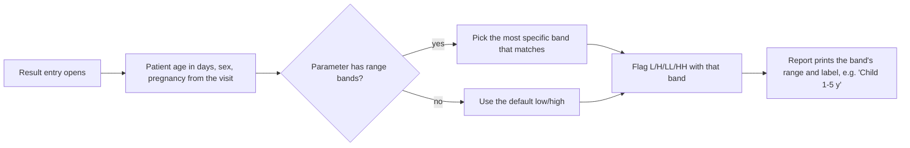

### 3.3 Data
In the Test Master parameter (`hospital-services.json → lab.parameters[]`), add an optional `ranges` array. The existing `low/high/critLow/critHigh` stay as the **default** band.
```json
{ "name": "Haemoglobin", "unit": "g/dL", "low": 12, "high": 17, "critLow": 7, "critHigh": 20,
  "ranges": [
    { "label": "Newborn (0-30 d)", "sex": "ANY", "ageFromDays": 0,   "ageToDays": 30,   "pregnant": null, "low": 14, "high": 22, "critLow": 10, "critHigh": 24 },
    { "label": "Child (1-12 y)",   "sex": "ANY", "ageFromDays": 365, "ageToDays": 4745, "pregnant": null, "low": 11, "high": 14 },
    { "label": "Adult female",     "sex": "F",   "ageFromDays": 4746,"ageToDays": null, "pregnant": false,"low": 12, "high": 15 },
    { "label": "Pregnancy",        "sex": "F",   "ageFromDays": 4746,"ageToDays": null, "pregnant": true, "low": 11, "high": 15, "critLow": 7 },
    { "label": "Adult male",       "sex": "M",   "ageFromDays": 4746,"ageToDays": null, "pregnant": null, "low": 13, "high": 17 }
  ],
  "altUnit": { "unit": "g/L", "factor": 10, "decimals": 0 } }
```
On the lab visit, add `pregnant: true | false | null` (asked at billing for female patients aged 12–55 when any ordered test has a pregnancy band). On each result, store the band actually used: `results[].rangeLabel`, `low`, `high` (a frozen copy, so later Test Master edits never change an old report — same rule as spec §37 versions).

### 3.4 Rules
| # | Rule |
|---|---|
| R1-1 | Age is calculated **in days** on the collection date (not today), from DOB; if only age in years is known, `years × 365`. |
| R1-2 | Matching band = sex matches (`ANY` matches all) **and** age inside `[from, to]` (`to: null` = no upper limit) **and** `pregnant` matches (`null` = any). |
| R1-3 | Several matches → the one with the **narrowest age span**; then one with `pregnant` set beats one with `null`; then the one with an exact sex beats `ANY`. |
| R1-4 | No match → default band; the report prints "Reference range: adult" so the doctor knows. |
| R1-5 | Missing critical limits in a band fall back to the default band's critical limits. |
| R1-6 | Test Master validation: bands of the same sex/pregnancy must not overlap in age; `low < high`; `critLow ≤ low`; `critHigh ≥ high`. |
| R1-7 | Unit conversion is **display only**: the value is stored in the main unit. A per-test setting `reportUnit: 'MAIN' | 'ALT' | 'BOTH'`; `BOTH` prints "5.6 mmol/L (101 mg/dL)". |

### 3.5 Screens
- **Test Master editor** (`#/lab/tests/{id}`): under each parameter, a small table of range bands with Add band / remove, and an optional alternative unit + factor.
- **Billing**: a *Pregnant?* Yes / No / Not known question, shown only when rule 3.3 applies.
- **Result entry / SID page**: the range column shows the band label underneath (muted text).
- **Report**: range + band label.

### 3.6 Demo seed
Bands for Haemoglobin, Platelets, Creatinine (male/female), TSH (pregnancy trimesters as three bands with label only), Glucose with `altUnit` mmol/L ↔ mg/dL (factor 18.016). Seed patients: a 3-year-old, a pregnant woman of 26, a man of 60.

### 3.7 Acceptance tests
| # | Test | Expected |
|---|---|---|
| T1-1 | Hb 12.5 for the 3-year-old | Normal is 11–14 → no flag; label "Child (1-12 y)" |
| T1-2 | Same value for the 60-year-old man | 13–17 → **L** |
| T1-3 | Pregnant woman, Hb 11.2 | Pregnancy band → no flag |
| T1-4 | Change the band in the Test Master after the report | Old report still prints the old range |
| T1-5 | Overlapping bands saved | Refused with the band names |

**[PROD]** The same rules in the server, plus range-band import from the analyser vendor's list.

---

## 4. P2-02 Critical value call log

> **Built 28 Nov 2026** — as-built rules in [LAB_MODULE_SPECIFICATION.md](LAB_MODULE_SPECIFICATION.md) §38.6.

### 4.1 Purpose
A critical result (LL / HH) must be **phoned to the doctor and written down before the report is released** (NABL practice). Today the demo only alerts.

### 4.2 Flow
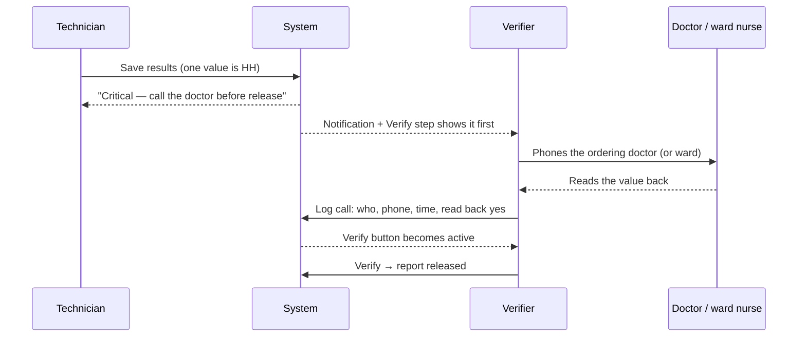

### 4.3 Data
On the order (`labVisits[].orders[]` or the order record used today), add:
```json
"criticalCalls": [
  { "at": "2026-11-27T10:42:00.000Z", "by": "USR-0007",
    "toName": "Dr. A. Ravichandran", "toRole": "DOCTOR", "phone": "+91 98…",
    "readBack": true, "outcome": "INFORMED", "note": "Will see patient now",
    "parameters": ["Potassium 6.9 mmol/L (HH)"] }
]
```
`outcome`: `INFORMED` · `NOT_REACHABLE` · `LEFT_MESSAGE`.

### 4.4 Rules
| # | Rule |
|---|---|
| R2-1 | An order with any LL / HH **cannot be verified** until it has at least one call with `outcome: INFORMED` and `readBack: true`. |
| R2-2 | `NOT_REACHABLE` is logged but does not unlock. After **15 minutes** without an INFORMED call, the alert escalates to the Super Admin ("Critical not yet informed — 15 min"). |
| R2-3 | If results are corrected and the critical value goes away, the call log stays (history) but the rule no longer blocks. A **new** critical value after correction needs a new call. |
| R2-4 | The report prints a line: "Critical value informed to Dr. … at 10:42 by … (read back)". |
| R2-5 | Setting `criticalCallRequired` (default **on**). Off = log optional (phase 1 behaviour). |
| R2-6 | The time from result saved to INFORMED call is the **critical call time**, shown on the lab dashboard (target ≤ 30 min). |

### 4.5 Screens
- SID page: under a critical order, a box "Critical — not informed yet" with **Log call**. The dialog has: name (pre-filled with the ordering doctor), role, phone (pre-filled from the doctor / ward), outcome, a read-back checkbox and a note.
- Verify button disabled with the reason as its tooltip.
- Lab home *Fix these first*: "Critical not informed" with the count (red).
- Report: the call line.

### 4.6 Acceptance tests
| # | Test | Expected |
|---|---|---|
| T2-1 | Save K 6.9 → try Verify | Disabled: "Call the doctor first" |
| T2-2 | Log NOT_REACHABLE | Still blocked; after 15 min the owner gets an alert |
| T2-3 | Log INFORMED + read back | Verify works; report prints the call line |
| T2-4 | Setting off | Verify works without a call |

---

## 5. P2-03 Delta checks and auto-verification

### 5.1 Delta check — purpose and rule
Compare a new result with the **same patient's previous verified result** of the same parameter. A big jump usually means a wrong sample or a wrong patient.

Per parameter in the Test Master:
```json
"delta": { "type": "PERCENT", "limit": 50, "withinDays": 7 }
```
`type`: `PERCENT` (|new − old| / old × 100) or `ABSOLUTE` (|new − old|).

| # | Rule |
|---|---|
| R3-1 | If a previous verified result exists within `withinDays` and the change is above `limit` → flag **D** (delta) beside the value. |
| R3-2 | A D flag needs the verifier to pick a reason before verifying: *Clinically expected* · *Sample re-checked* · *Recollected* · *Other (note)*. Stored as `results[].deltaReason`. |
| R3-3 | D is shown on screen only. It is **not printed** on the patient report. |
| R3-4 | "Recollect" from the delta dialog uses the existing reject → recollect flow (reason *Suspected wrong sample*). |

### 5.2 Auto-verification — purpose
Normal, unremarkable results can be released without a person clicking Verify, by rules **approved by the pathologist**.

Rule record (`data/lab-autoverify-rules.json`):
```json
{ "id": "AVR-0001", "serviceId": "SRV-0001", "active": true,
  "approvedBy": "USR-0001", "approvedAt": "…", "version": 1,
  "conditions": { "allNormal": true, "noDelta": true, "qcPassedToday": true,
                  "notFirstResultForPatient": false, "sources": ["OP","SELF","REF","PKG"],
                  "maxAgeYears": null } }
```

### 5.3 Auto-verification flow
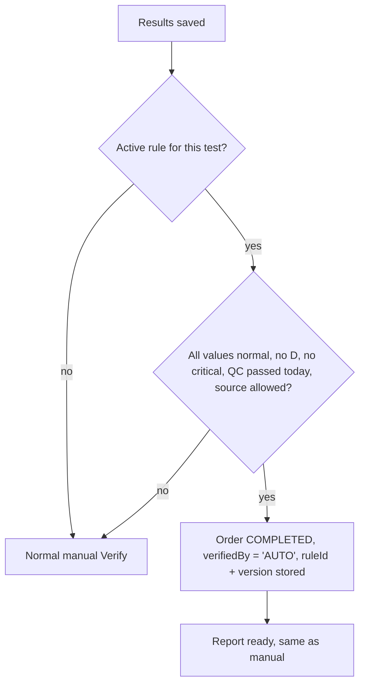

| # | Rule |
|---|---|
| R3-5 | Only a **Super Admin** (as the pathologist's approval) can create, change or switch on a rule. Each change makes a new version; old reports keep the version that released them. |
| R3-6 | Never auto-verify: any flag (L, H, LL, HH, A, D), IP / casualty source unless the rule allows it, a corrected result, or a test with a text "comment" parameter that is filled. |
| R3-7 | The report prints "Verified by: Auto-verification (rule AVR-0001 v1, approved by Dr …)". |
| R3-8 | Global setting `autoVerifyEnabled` (default **off**). A daily audit list shows every auto-verified report so the pathologist can spot-check. |

### 5.4 Screens
- Test Master → parameter: delta type, limit, days.
- Setup → **Auto-verification rules** (Super Admin): list + editor with the conditions as checkboxes.
- SID page: D flag with a tooltip "Previous 12.8 on 20 Nov (−48 %)"; delta reason dropdown in Verify.
- Reports → *Auto-verified today* (pathologist spot-check list).

### 5.5 Acceptance tests
| # | Test | Expected |
|---|---|---|
| T3-1 | Hb 13.0 three days after 8.0 (limit 50 %) | D flag; Verify asks for a reason |
| T3-2 | All-normal CBC with an active rule, QC passed | Completed instantly, "Auto-verification" on the report |
| T3-3 | Same, but one value H | Goes to manual Verify |
| T3-4 | QC failed today | Not auto-verified |

---

## 6. P2-04 QC module (Levey-Jennings, Westgard)

### 6.1 Purpose
Every analyser runs control samples (normal / abnormal levels) each day. If a control is out, **patient results on that analyte must not be released** until the problem is fixed.

### 6.2 Flow
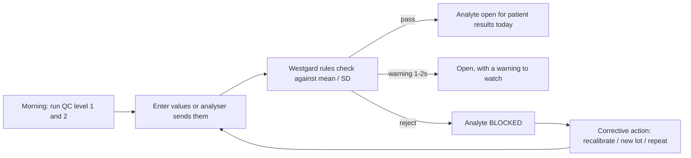

### 6.3 Data
`data/lab-qc-materials.json` — the control material and its target:
```json
{ "id": "QCM-0001", "name": "Bio-Rad Lyphochek Assayed Chemistry", "level": 1,
  "lotNo": "26431", "expiry": "2027-03-31", "kitId": "KIT-0012",
  "targets": [ { "serviceId": "SRV-0004", "parameter": "Glucose", "mean": 95, "sd": 3.0, "unit": "mg/dL" } ],
  "active": true }
```
`data/lab-qc-runs.json` — one row per control measurement:
```json
{ "id": "QCR-000001", "materialId": "QCM-0001", "serviceId": "SRV-0004", "parameter": "Glucose",
  "analyser": "AN-01", "value": 101.5, "z": 2.17, "at": "…", "by": "USR-0007",
  "result": "WARN", "rules": ["1-2s"], "action": null }
```
`result`: `PASS` · `WARN` · `REJECT`. `action` (on REJECT): `{ type: 'RECALIBRATED'|'NEW_LOT'|'REPEATED'|'SERVICE_CALL'|'OTHER', note, by, at }`.

### 6.4 Westgard rules used (z = (value − mean) / SD)
| Rule | Fires when | Result |
|---|---|---|
| 1-2s | one value beyond ±2 SD | WARN |
| 1-3s | one value beyond ±3 SD | REJECT |
| 2-2s | two in a row beyond 2 SD on the same side (same level, or level 1 and 2 in the same run) | REJECT |
| R-4s | in one run, one level > +2 SD and the other < −2 SD | REJECT |
| 4-1s | four in a row beyond 1 SD on the same side | REJECT |
| 10-x | ten in a row on the same side of the mean | REJECT |

### 6.5 Rules
| # | Rule |
|---|---|
| R4-1 | An analyte is **open** for today when its latest run today on every active level is PASS or WARN. |
| R4-2 | Analyte **blocked** (REJECT, or no QC run today when the setting `qcRequiredDaily` is on) → result entry still allowed but **Verify is disabled** for that parameter with "QC failed — Glucose blocked since 08:10". |
| R4-3 | A REJECT run needs a corrective action before a repeat run can unblock. |
| R4-4 | QC material use is deducted from lab stock (the existing QC movement type in §16). |
| R4-5 | Expired QC lot cannot be used for a run. |
| R4-6 | Patient results released while a later QC failed the same day are listed on the QC screen as "Results to review" (look-back). |

### 6.6 Screens
- `#/lab/qc` (new tab in the lab sidebar group): today's board — one row per analyte × level with the last value, z, result, and an **Enter QC** button. Blocked analytes at the top.
- **Levey-Jennings chart** per analyte/level: last 30 runs, lines at mean, ±1, ±2, ±3 SD (uses the shared chart helper, plain lines).
- Corrective action dialog.
- SID page and worklist: a muted "QC blocked" note beside the affected test.
- Lab home *Fix these first*: "QC failed" (red) and "QC not run today".

### 6.7 Demo seed
Two levels for Glucose, Creatinine and Hb, with 30 days of runs: mostly PASS, one 1-2s WARN, and today a 1-3s REJECT on Creatinine level 2 (so the block is visible immediately).

### 6.8 Acceptance tests
| # | Test | Expected |
|---|---|---|
| T4-1 | Open the QC board | Creatinine blocked; others open |
| T4-2 | Try to verify a creatinine result | Disabled with the QC reason |
| T4-3 | Log the action, enter a passing repeat | Unblocked; verify works |
| T4-4 | Enter 2 SD high twice in a row | 2-2s REJECT |
| T4-5 | LJ chart | Points and SD lines match the data |

---

## 7. P2-05 Analyser interface (simulated)

### 7.1 Purpose
In production, analysers talk to the HMS through middleware using **HL7 v2** (ORM order / ORU result) or **ASTM E1394**. The demo builds the full flow with a **simulator**, so staff can try it and developers see the exact messages.

### 7.2 Flow
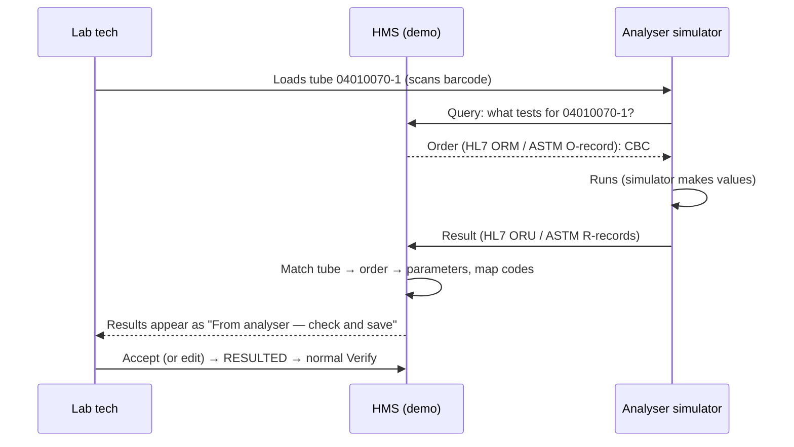

### 7.3 Data
`data/lab-analysers.json`:
```json
{ "id": "AN-01", "name": "Sysmex XN-350 (Haematology)", "protocol": "ASTM", "department": "Haematology",
  "connection": { "type": "SIMULATED", "host": null, "port": null },
  "testMap": [ { "analyserCode": "HGB", "serviceId": "SRV-0001", "parameter": "Haemoglobin", "factor": 1 },
               { "analyserCode": "WBC", "serviceId": "SRV-0001", "parameter": "Total WBC count", "factor": 1000 } ],
  "active": true }
```
`data/lab-analyser-messages.json` — every message in and out, kept as raw text:
```json
{ "id": "AM-000001", "analyserId": "AN-01", "direction": "IN", "kind": "RESULT",
  "tube": "04010070-1", "raw": "H|\\^&|||XN-350…\rP|1\rO|1|04010070-1||^^^HGB…\rR|1|^^^HGB|11.8|g/dL|…\rL|1|N",
  "status": "MATCHED", "error": null, "at": "…" }
```
`status`: `RECEIVED` → `MATCHED` | `UNMATCHED` (tube not found) | `UNMAPPED` (code not in testMap) | `ERROR`. Results from a message land on the order as `pendingResults` (not yet saved), with `source: 'ANALYSER'`, `messageId`.

### 7.4 Rules
| # | Rule |
|---|---|
| R5-1 | Matching is **by tube code only** (never by name). Tube must be *received*; otherwise UNMATCHED "Tube not received yet". |
| R5-2 | Analyser values are **never saved automatically**: the technician sees them pre-filled and clicks *Accept* (or edits). With P2-03 auto-verification, accepted results can then auto-verify. |
| R5-3 | An edited analyser value keeps both: `analyserValue` and `value`, plus `editedBy`. The report shows the final value; the audit shows the change. |
| R5-4 | QC results from the analyser (sample ID = QC lot) go to `lab-qc-runs` (P2-04), not to a patient. |
| R5-5 | UNMATCHED / UNMAPPED messages appear on the interface screen for a person to fix (link to the right tube or add the code map). |
| R5-6 | A repeat result for the same tube + code creates a new pending set; the older one is marked *superseded*. |

### 7.5 Screens
- `#/lab/analysers` (Admin / Lab): analyser list, code map editor, message log with raw text (copy button), unmatched queue.
- **Simulator panel** (demo only, clearly labelled "Simulator"): scan / type a tube → *Run* → shows the outgoing order message and the incoming result message; optional *Make it abnormal / critical* to test flags.
- SID page: "From analyser AN-01 at 10:31 — Accept all / Edit" on top of the result form.

### 7.6 Acceptance tests
| # | Test | Expected |
|---|---|---|
| T5-1 | Simulate a received CBC tube | ORM shown, ORU arrives, values pre-filled |
| T5-2 | Accept | Order RESULTED, `source: ANALYSER` in audit |
| T5-3 | Simulate a tube not yet received | UNMATCHED in the queue |
| T5-4 | Code `MCV` not mapped | UNMAPPED; add map → re-process works |

**[PROD]** Middleware (e.g. Mirth Connect) listens on TCP/serial, turns messages into the same JSON, and posts to `/lab/analyser-messages`. Same statuses and matching rules.

---

## 8. P2-06 Outsourced tests (send-out)

### 8.1 Purpose
Some tests (e.g. vitamin D, special hormones, genetic tests) are sent to a reference lab. The patient still pays Nallam Hospital, the sample leaves, and the result comes back as a PDF / values.

### 8.2 Flow
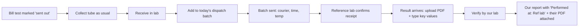

### 8.3 Data
Test Master: `lab.outsource: { refLabId, cost, sendDays: ["MON","WED","FRI"], tatDays: 4 }` (`null` = done in-house).
`data/lab-ref-labs.json`: `{ id, name, address, phone, contact, nablNo, active }`.
`data/lab-dispatches.json`:
```json
{ "id": "DSP-2026-0012", "refLabId": "RL-0001", "status": "SENT",
  "tubes": ["04010070-2"], "createdAt": "…", "sentAt": "…", "courier": "Hosur Express", "docketNo": "HX55120",
  "tempOk": true, "receivedAtRefAt": null, "by": "USR-0007" }
```
`status`: `OPEN` → `SENT` → `RECEIVED_AT_REF` → `CLOSED` (all results back) | `PROBLEM` (sample lost / rejected by ref lab).
On the order: `outsource: { dispatchId, refLabId, refNo, resultPdfId, receivedAt }`.

### 8.4 Rules
| # | Rule |
|---|---|
| R6-1 | Report due date = sent date + `tatDays` (shown at billing as "Report by Fri"). |
| R6-2 | A sent-out order skips *Enter results* until the ref lab result is in; the worklist shows it under a new filter "With reference lab". |
| R6-3 | Ref lab rejects the sample → order back to *Recollect* with reason, patient informed. |
| R6-4 | The result PDF is stored like prescriptions (IndexedDB attachment store) and **attached** to our report; key values typed in get our normal flags. |
| R6-5 | Cost vs price is kept per order for the *Send-out margin* report. |
| R6-6 | Overdue send-out (past due date, no result) → lab alert + *Fix these first*. |

### 8.5 Screens
- Test Master: "Done at" In-house / Reference lab + fields.
- `#/lab/sendout`: tubes waiting to dispatch → make batch → print manifest (paper, white) → mark sent → mark received / result in.
- SID page: "Performed at: … · Ref no …" and the PDF.

### 8.6 Acceptance tests
| # | Test | Expected |
|---|---|---|
| T6-1 | Bill Vitamin D | Report date = next send day + 4 |
| T6-2 | Dispatch → sent → result PDF + value → verify | Report shows ref lab line and PDF |
| T6-3 | Ref lab rejects | Order to recollect, patient message ready |

---

## 9. P2-07 Home sample collection

### 9.1 Purpose
A patient books a home visit; a phlebotomist collects at home; tubes come back to the lab.

### 9.2 Flow
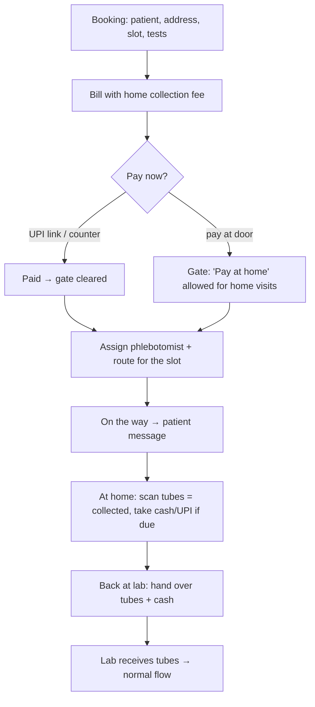

### 9.3 Data
`data/lab-home-visits.json`:
```json
{ "id": "HV-2026-0041", "visitId": "LV-00071", "patientId": "PAT-0031",
  "address": "12, Gandhi Nagar, Hosur", "landmark": "Near water tank", "pin": "635109", "mapLink": null,
  "slot": { "date": "2026-11-28", "from": "07:00", "to": "08:00" },
  "phlebotomistId": "USR-0007", "routeOrder": 2,
  "status": "ASSIGNED", "payAtDoor": 650, "collectedCash": null,
  "events": [ { "status": "BOOKED", "at": "…", "by": "USR-0005" } ] }
```
`status`: `BOOKED` → `ASSIGNED` → `ON_THE_WAY` → `COLLECTED` → `HANDED_TO_LAB` | `CANCELLED` | `NOT_AT_HOME` (rebook).
Lab visit: `source: 'HOME'`, `collectionPoint: 'HOME'`. New service "Home collection fee" in `hospital-services.json`.

### 9.4 Rules
| # | Rule |
|---|---|
| R7-1 | Slots: setting `homeSlots` (e.g. 6:30–10:30, hourly) and `homeMaxPerSlot` per phlebotomist. A full slot cannot be booked. |
| R7-2 | Fasting tests in the order → only slots before 10:00 are offered, and the patient message says "Do not eat after 10 pm". |
| R7-3 | **Pay at door** clears the gate only for collection; the report is held until the cash is handed over at the lab (the payment is entered in the phlebotomist's shift, §12 of the BRD). |
| R7-4 | **Payment link** (demo): a UPI `upi://pay?…` link and QR in the message, status `LINK_SENT`; marking it paid is manual (counter checks the bank). **[PROD]** payment gateway webhook. |
| R7-5 | Tube time limit: if `HANDED_TO_LAB` is more than `homeMaxTransitMins` (default 120) after `COLLECTED`, receipt asks "Sample delayed — accept or reject". |
| R7-6 | NOT_AT_HOME → patient message + rebook option; fee policy by setting. |

### 9.5 Screens
- Reception: **Book home collection** (from the lab bill screen as a fourth collection point "Home").
- `#/lab/home`: day board by slot and phlebotomist; route list in visit order (address, phone, tests, amount to collect); *On the way / Collected / Not at home* buttons; printable run sheet.
- Hand-over at the lab: scan the tubes, count the cash → receive.
- Messages: booked, on the way, collected, report ready.

### 9.6 Acceptance tests
| # | Test | Expected |
|---|---|---|
| T7-1 | Book a fasting test | Only early slots; fasting note in message |
| T7-2 | Pay at door, collect, hand over cash | Report released only after cash is entered |
| T7-3 | Hand over 3 h after collection | Delayed-sample question |
| T7-4 | Slot full | Not offered |

---

## 10. P2-08 Microbiology, histopathology, blood bank

These are **new departments**. They use the same patient, bill, SID, tube / specimen labels, delivery and audit as the lab, but have their own result steps. Each appears as its own tab group in the lab sidebar (`Microbiology`, `Histopathology`, `Blood bank`), visible by permission.

### 10.1 P2-08a Microbiology — culture and sensitivity

**Flow**
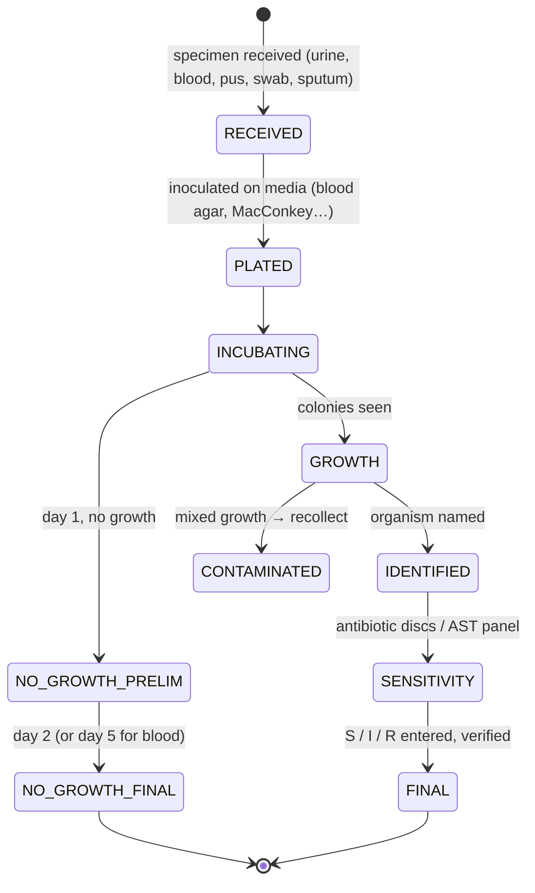

**Data** — `data/micro-cultures.json` (one per culture order):
```json
{ "id": "MC-2026-0007", "orderId": "ORD-00140", "specimen": "URINE", "collectedAt": "…",
  "media": ["BLOOD_AGAR","MACCONKEY"], "status": "SENSITIVITY",
  "readings": [ { "day": 1, "at": "…", "by": "USR-0007", "growth": "GROWTH", "colonyCount": ">10^5 CFU/mL", "note": "Lactose fermenter" } ],
  "organisms": [ { "name": "Escherichia coli", "count": ">10^5 CFU/mL",
      "ast": [ { "antibiotic": "Nitrofurantoin", "result": "S", "mic": null },
               { "antibiotic": "Ciprofloxacin", "result": "R", "mic": null } ] } ],
  "prelimReportAt": "…", "finalReportAt": null }
```
`data/micro-antibiotics.json`: panels per organism group / specimen (e.g. *Urine — Gram negative*: Nitrofurantoin, Ciprofloxacin, Cotrimoxazole, Ceftriaxone, Amikacin, Meropenem).

**Rules**
| # | Rule |
|---|---|
| RM-1 | A **preliminary report** can be released at any reading ("No growth after 24 h — final report to follow"); the visit is PARTIAL until the final. |
| RM-2 | Final needs organism(s) + AST for each, or a no-growth final at the right day (urine/pus day 2, blood day 5 — setting per specimen). |
| RM-3 | Max 2 organisms per report; 3 or more = "Mixed growth — please send a fresh sample" (contaminated). |
| RM-4 | Restricted antibiotics (e.g. carbapenems, colistin) are **suppressed** on the report when the organism is sensitive to first-line drugs (setting); shown on screen. |
| RM-5 | Blood culture positive = **critical** → P2-02 call log applies. |
| RM-6 | Each day's reading is a separate audit entry (who read the plate, when). |

**Screens**: Micro worklist by status and day due ("Read today"), culture card with daily readings, AST grid (S / I / R buttons), prelim and final report formats.

### 10.2 P2-08b Histopathology

**Flow**
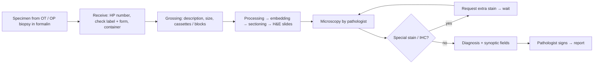

**Data** — `data/histo-cases.json`:
```json
{ "id": "HP-2026-0019", "orderId": "ORD-00152", "specimen": "Gall bladder", "site": "", "clinicalHistory": "…",
  "receivedAt": "…", "fixative": "10% formalin", "status": "MICROSCOPY",
  "gross": { "text": "Gall bladder measuring 7 × 3 cm…", "by": "USR-0001", "at": "…" },
  "blocks": [ { "id": "A1", "desc": "Fundus" }, { "id": "A2", "desc": "Neck" } ],
  "slides": [ { "id": "A1-1", "stain": "H&E", "madeAt": "…" } ],
  "extraStains": [],
  "micro": "", "diagnosis": "", "icdO": null, "signedBy": null, "signedAt": null,
  "addenda": [] }
```
`status`: `RECEIVED` → `GROSSED` → `PROCESSING` → `SLIDES_READY` → `MICROSCOPY` → `SIGNED` (+ `ADDENDUM`).

**Rules**
| # | Rule |
|---|---|
| RH-1 | HP number is separate from SID: `HP-YYYY-NNNN`, printed on every block and slide label. |
| RH-2 | Only the pathologist (permission `histo.sign`) can sign. Signed reports cannot be edited — only an **addendum** (dated, signed) can be added. |
| RH-3 | Default TAT 3 working days, 5 with special stains; overdue shows on the lab home. |
| RH-4 | Malignant diagnosis → the treating doctor is phoned (P2-02 call log). |
| RH-5 | Blocks and slides are kept — a **retrieval register** like MRD (who took block A1 for review, returned when). |

**Screens**: Histo worklist by status, case page (gross, blocks / slides table, microscopy, diagnosis), block/slide label print, report with pathologist signature block.

### 10.3 P2-08c Blood bank (storage and issue centre)

Demo scope is a **blood storage centre**: units come from a licensed blood bank; the hospital groups, cross-matches, stores and issues them. Donor collection is out of scope (needs a licence and its own module).

**Flow**
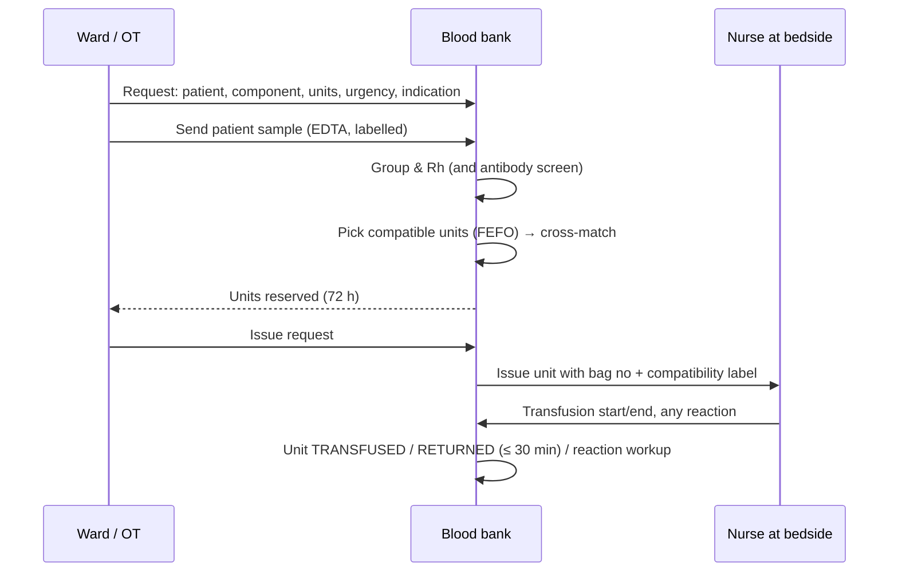

**Data**
- `data/bb-units.json`: `{ id: 'BU-…', bagNo, component: 'PRBC'|'FFP'|'PLT'|'WB'|'CRYO', group: 'B', rh: 'POS', volumeMl, collectedOn, expiry, source: 'Hosur GH Blood Bank', status, reservedFor, issuedAt, … }` — `status`: `QUARANTINE` → `AVAILABLE` → `RESERVED` → `ISSUED` → `TRANSFUSED` | `RETURNED` → `AVAILABLE` | `DISCARDED` (expired / broken / reaction).
- `data/bb-requests.json`: `{ id: 'BR-…', patientId, ipNo, component, units, urgency: 'ROUTINE'|'URGENT'|'EMERGENCY', indication, sampleTube, patientGroup, crossmatches: [{ unitId, result: 'COMPATIBLE'|'INCOMPATIBLE', by, at }], status }` — `status`: `REQUESTED` → `GROUPED` → `CROSSMATCHED` → `ISSUED` → `CLOSED` | `CANCELLED`.
- `data/bb-transfusions.json`: start/end time, vitals, nurse, reaction `{ type, at, actions }`.

**Rules**
| # | Rule |
|---|---|
| RB-1 | **No issue without a compatible cross-match** for red cells — except EMERGENCY: O-negative PRBC may be issued uncross-matched with doctor's name + reason; cross-match done after (retrospective). |
| RB-2 | Patient's group must be confirmed on **two separate samples** (or two tests on one sample, setting) before group-specific blood is issued. |
| RB-3 | Expired units cannot be reserved or issued; units expiring in 3 days are shown first (FEFO). |
| RB-4 | Reservation lapses after 72 h → unit back to AVAILABLE. |
| RB-5 | Returned unit is re-accepted only if back within **30 minutes** and the cold chain is confirmed; otherwise DISCARDED. |
| RB-6 | Bedside check (issue screen): scan patient wristband / enter IP no + scan bag no → must match the request. |
| RB-7 | Transfusion reaction = critical alert to the doctor and the Super Admin; the unit and the patient's post sample are investigated. |
| RB-8 | Charges: grouping, cross-match and processing fee per unit are billed to the IP account (same as ward lab orders). |

**Screens**: Blood bank stock board (group × component counts, expiring soon), receive units, requests queue, cross-match entry, issue with bedside check, transfusion record, registers (issue, discard).

### 10.4 Acceptance tests (P2-08)
| # | Test | Expected |
|---|---|---|
| TM-1 | Urine culture: day 1 no growth → prelim; day 2 no growth → final | Two reports; visit PARTIAL then READY |
| TM-2 | Growth → E. coli → AST → final | S/I/R table on report; restricted drug hidden |
| TM-3 | Positive blood culture | Critical call log needed |
| TH-1 | Sign a histo report → try to edit | Refused; Addendum allowed |
| TB-1 | Issue PRBC without cross-match (routine) | Refused |
| TB-2 | Emergency O-neg | Allowed with reason; retrospective cross-match pending |
| TB-3 | Return after 45 min | Unit discarded |
| TB-4 | Scan wrong bag at issue | Refused: "Bag not for this patient" |

---

## 11. P2-09 Patient portal and ABHA linking

### 11.1 Purpose
A patient opens their own reports with their phone number, without staff help.

### 11.2 Flow
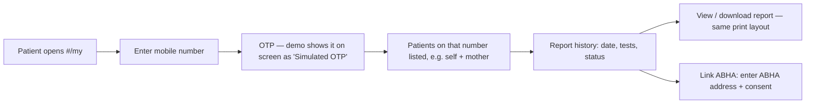

### 11.3 Data
- `data/portal-sessions.json` (demo only): `{ phone, otp, createdAt, verifiedAt }` — OTP expires in 5 min, 3 tries.
- Patient: `abha: { number: '91-xxxx-xxxx-xxxx', address: 'name@abdm', linkedAt, consentAt }`.
- Outbox message (`messages.json`) for ABHA: `{ provider: 'ABDM', template: 'HIP_LINK', status: 'QUEUED_FOR_SERVER' }`.

### 11.4 Rules
| # | Rule |
|---|---|
| R9-1 | Only **released** reports (all or partial verified) are shown; never results awaiting verification. |
| R9-2 | Reports with a pending due balance show "Collect at the counter" instead of View (setting `portalHideUnpaid`, default on). |
| R9-3 | Every portal view is audited (`PORTAL_VIEW`, phone, report). |
| R9-4 | The portal is a separate, minimal page (no sidebar); it never shows other patients' data or staff screens. |
| R9-5 | ABHA linking needs explicit consent with date; unlink removes the link but keeps the audit. |

**[PROD]** Real OTP via SMS gateway; ABDM HIP integration (care-context linking, consent manager) through the backend.

### 11.5 Acceptance tests
| # | Test | Expected |
|---|---|---|
| T9-1 | Enter a seed phone + OTP | Only that number's patients shown |
| T9-2 | Report awaiting verification | Not listed |
| T9-3 | Wrong OTP 3 times | Locked for 15 min |

---

## 12. P2-10 Tamil messages and report headings

### 12.1 Data
- Patient: `language: 'en' | 'ta'` (asked at registration, default `en`).
- Templates in `hospital-settings.json → messaging.templates` get a `ta` copy beside `en`:
```json
"REPORT_READY": {
  "en": "Dear {name}, your lab report (SID {sid}) is ready. {link} — Nallam Hospital",
  "ta": "வணக்கம் {name}, உங்கள் ஆய்வக அறிக்கை (SID {sid}) தயாராக உள்ளது. {link} — நல்லம் மருத்துவமனை"
}
```
- Report headings: `reportLanguage: 'en' | 'en+ta'`. `en+ta` prints bilingual headings, e.g. *LABORATORY REPORT / ஆய்வக அறிக்கை*, *Test / பரிசோதனை*, *Result / முடிவு*, *Reference range / இயல்பு அளவு*. Test names, units and values stay in English (medical standard).

### 12.2 Rules
| # | Rule |
|---|---|
| R10-1 | The message uses the patient's language; a missing `ta` template falls back to `en`. |
| R10-2 | Staff can switch the language in the send dialog before sending. |
| R10-3 | Tamil text in this document is a first draft — **the hospital must approve the final wording** (open question Q9). |
| R10-4 | Fonts: the report uses a Tamil-capable font (Noto Sans Tamil) loaded with the page so print works offline. |

### 12.3 Acceptance tests
| # | Test | Expected |
|---|---|---|
| T10-1 | Tamil patient, Send on WhatsApp | Tamil text in the `wa.me` link |
| T10-2 | `en+ta` report | Bilingual headings; values unchanged |

---

## 13. P2-11 Referral statements

### 13.1 Legal note (read first)
Paying a doctor for referring patients can be against the National Medical Commission's professional conduct rules and the hospital's own policy. So this item is designed as a **referral activity statement** (how many patients and tests each outside doctor referred, and the report copies sent). A money column (commission) is **off by default** and must not be switched on until the hospital confirms it is legally cleared (open question Q7).

### 13.2 Flow
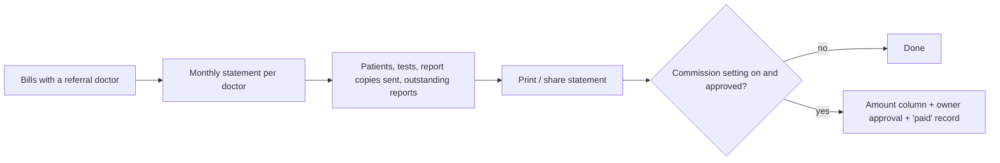

### 13.3 Data
- `data/referral-statements.json`: `{ id: 'RS-2026-11-RD-0001', referralDoctorId, month: '2026-11', lines: [{ visitId, date, patientId, tests, billNet }], totals, status: 'DRAFT'|'FINAL', amount: null, approvedBy: null, paidRecord: null }`.
- Setting `referralCommission: { enabled: false, policyApprovedBy: null, rules: [] }`.

### 13.4 Rules
| # | Rule |
|---|---|
| R11-1 | Statement includes completed (non-cancelled) visits only. |
| R11-2 | Patient names are masked on a statement that is shared outside (initials + SID), full on the internal copy. |
| R11-3 | The amount column exists only when the setting is enabled and approved; the demo **records** any payment, it never moves money. |

---

## 14. P2-12 Token audio and second display

### 14.1 Flow
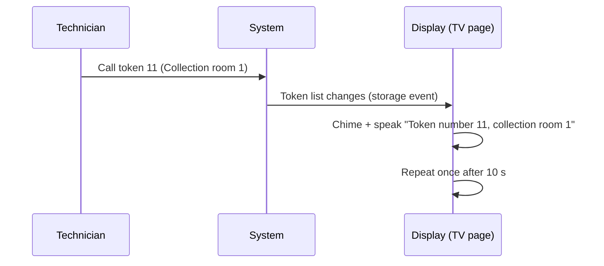

### 14.2 Data and rules
- Each call stores `counter` (e.g. `"Collection room 1"`), chosen once per workstation (`localStorage`), beside the existing `callNo`.
- Display page `#/lab/display?counter=all|<name>&audio=on&lang=en|ta`: a second TV can show one counter only.
- Audio uses the browser's speech synthesis (`speechSynthesis`) in English or Tamil ("டோக்கன் எண் 11, சேகரிப்பு அறை 1"), preceded by a short chime. Browsers need **one click on the display page** to allow sound — the page shows "Click to turn on sound" until then.
- "Call again" speaks again. Calls older than 30 min drop off the screen.
- **[PROD]** a dedicated display device with push updates; the same `counter` + `callNo` data.

### 14.3 Acceptance tests
| # | Test | Expected |
|---|---|---|
| T12-1 | Call token on room 1, display `counter=all` | Spoken once, repeated after 10 s |
| T12-2 | Second display `counter=Collection room 2` | Does not show room 1 calls |

---

## 15. Data model summary (new JSON files and fields)

### 15.1 New JSON files (all in `data/`, all arrays)
| File | Item | Holds |
|---|---|---|
| `lab-autoverify-rules.json` | P2-03 | Auto-verification rules (versioned) |
| `lab-qc-materials.json` | P2-04 | Control materials, levels, lots, targets |
| `lab-qc-runs.json` | P2-04 | QC measurements, Westgard result, actions |
| `lab-analysers.json` | P2-05 | Analysers and code maps |
| `lab-analyser-messages.json` | P2-05 | Raw messages in / out and match status |
| `lab-ref-labs.json` | P2-06 | Reference labs |
| `lab-dispatches.json` | P2-06 | Send-out batches |
| `lab-home-visits.json` | P2-07 | Home collection bookings |
| `micro-cultures.json`, `micro-antibiotics.json` | P2-08a | Cultures, readings, organisms, AST; antibiotic panels |
| `histo-cases.json` | P2-08b | Histopathology cases, blocks, slides, addenda |
| `bb-units.json`, `bb-requests.json`, `bb-transfusions.json` | P2-08c | Blood units, requests / cross-match, transfusions |
| `portal-sessions.json` | P2-09 | Demo OTP sessions |
| `referral-statements.json` | P2-11 | Monthly referral statements |

### 15.2 New fields on existing records
| Record | Field | Item |
|---|---|---|
| Test parameter | `ranges[]`, `altUnit`, `delta` | P2-01, P2-03 |
| Test (`lab`) | `reportUnit`, `outsource`, `department: 'Microbiology'|'Histopathology'` | P2-01, P2-06, P2-08 |
| Lab visit | `pregnant`, `source: 'HOME'`, `collectionPoint: 'HOME'`, token `counter` | P2-01, P2-07, P2-12 |
| Order result | `rangeLabel`, `deltaReason`, `source: 'ANALYSER'`, `analyserValue`, `messageId` | P2-01, P2-03, P2-05 |
| Order | `criticalCalls[]`, `outsource{}`, `autoVerify{ ruleId, version }`, `pendingResults` | P2-02, P2-06, P2-03, P2-05 |
| Patient | `language`, `abha{}` | P2-10, P2-09 |
| Settings | `criticalCallRequired`, `autoVerifyEnabled`, `qcRequiredDaily`, `homeSlots`, `homeMaxPerSlot`, `homeMaxTransitMins`, `portalHideUnpaid`, `reportLanguage`, `referralCommission` | all |

### 15.3 New permission codes
| Code | Who (default) |
|---|---|
| `lab.critical.log` | Lab, Super Admin |
| `lab.autoverify.manage` | Super Admin |
| `lab.qc` (run + actions) / `lab.qc.manage` (materials, targets) | Lab / Admin, Super Admin |
| `lab.analyser.manage` | Admin, Super Admin |
| `lab.sendout` | Lab |
| `lab.home.book` / `lab.home.run` | Reception / Lab |
| `micro.work`, `histo.work`, `histo.sign` | Lab / Lab / Super Admin (pathologist) |
| `bb.work`, `bb.issue`, `bb.request` | Lab / Lab / Service Counter (ward) |
| `referral.statement` | Super Admin |

---

## 16. Planned demo code map

| File (new unless stated) | Holds |
|---|---|
| `assets/js/labranges.js` | Band matching, age in days, unit conversion (P2-01) |
| `assets/js/labflow.js` (existing) | Critical call log, delta check, auto-verify hook, home visit, send-out states |
| `assets/js/labqc.js` | Westgard rules, QC status per analyte, look-back (P2-04) |
| `assets/js/labinterface.js` | ASTM / HL7 build + parse, matching, simulator (P2-05) |
| `assets/js/micro.js`, `assets/js/histo.js`, `assets/js/bloodbank.js` | Department logic (P2-08) |
| `assets/js/modules/lab/qc.js` | `#/lab/qc` board + LJ chart |
| `assets/js/modules/lab/analysers.js` | `#/lab/analysers` + simulator |
| `assets/js/modules/lab/sendout.js` | `#/lab/sendout` |
| `assets/js/modules/lab/home.js` | `#/lab/home` |
| `assets/js/modules/micro.js`, `modules/histo.js`, `modules/bloodbank.js` | Department screens |
| `assets/js/modules/portal.js` | `#/my` patient portal |
| `tools/hospital-data.mjs` (existing) | Seed for every new file (C-9) |

---

## 17. Change log

Every build of a phase 2 item adds a row here **and** a short entry under it: what was built, files changed, new data, test results (T-numbers passed / failed), differences from this design.

| Date | Version | Item | Change |
|---|---|---|---|
| 2026-11-27 | 0.1 | All | Phase 2 flows designed (this document). Nothing built yet. |
| 2026-11-28 | 0.2 | P2-01, P2-02 | Built together with the compliance must-fix items F1–F6. |

**0.2 — P2-01 and P2-02 built (28 Nov 2026).**
- *Built:* per-parameter ranges by sex, age (days / months / years) and pregnancy in the Test Master; most specific range wins; overlap check; pregnancy question at billing and on the SID page; range name printed. Critical call log (Informed / Not reachable / Left a message, read-back) blocks verification; alert after 15 min; call printed on the report.
- *Files:* `labrules.js` (new), `hospital.js`, `labmaster.js`, `labflow.js`, `modules/lab/master.js`, `modules/lab/sid.js`, `modules/labdesk.js`, `modules/hbilling.js`, `alert-rules.js`, `modules/home.js`, `modules/setup.js`, `tools/hospital-data.mjs`.
- *Data:* `parameter.ranges[]`, `labVisit.pregnant`, `order.lab.criticalCalls[]`, `order.lab.criticalSince`; settings `criticalCallRequired`, `criticalEscalateMins`.
- *Tests:* checked in the browser — child Hb on the child range, pregnancy Hb and TSH on the pregnancy range, verify refused without a call and without read-back, verify after a proper call, call kept after correcting a normal value and required again after changing the critical value.
- *Differences from this design:* unit conversion (`altUnit`) is not built yet; an amendment that gives a critical value is allowed and then asks for a call after release (alert to the owner) instead of blocking the amendment.
